<h2>What is this document?</h2>

This guide is intended for new users to midi-qol who need some guidance on setting the very many options that exist.

## Table of contents
[TOC]

## What can midi-qol do?
Quite a lot, depending on how you configure it; at its simplest, it can speed up rolling by reducing the number of clicks/popups. To help illustrate some of its capabilities, here's an example: a spider attacking a goblin using the base dnd5e system.  
  
dnd5e has displayed a chat card with Attack and Damage buttons for the bite. The poison is a second activity on the same item, a Constitution save with its own damage. You go through the following steps
  * Press the attack button which prompts you to decide if the attack is made with advantage or disadvantage and whether there are any special bonuses, like luck/bardic inspiration.
  * Decide if the attack hit remembering to deal with any reactions the target might take, like a shield spell.
  * If the attack hit, roll the damage remembering to check if it is a critical hit and if there are any special bonuses for the damage, like a mace of disruption/dragon slayer sword.
  * Apply the damage using the system damage tray
  * Roll the saving throw, remembering if the save is made with advantage/disadvantage and any bonuses to apply
  * Use the poison save activity and roll its damage, taking half on a successful save
  * Apply the poison damage using the system damage tray, remembering to use 0.5x if the save succeeded
  * Manually apply any special effects that the attack might have, e.g. the poisoned condition (not in this example).

Midi-qol exists to help you automate some or all of these steps. Before going through the detail of how to set this up here is the same attack done with midi-qol with full automation, all accomplished with a single click of the item button.

| 

Here's what happened with that single click:
  * The attack roll was made (16)
  * The attack was determined to have hit the goblin (AC 15)
  * Because of that, damage was rolled: the bite (4 piercing) and, from the poison save activity, the poison (8). The attack runs the save activity after it because the attack's *Other Activity* is the poison save (see *Other Activity Default* below)
  * A Constitution save was rolled for the goblin against DC 11, and the goblin succeeded (17)
  * Damage was applied to the goblin accordingly (full piercing damage, as the goblin has no resistances, and half poison damage, as the goblin succeeded the save): 8 in all, which took the goblin from 7 HP to 0
  * A damage card (below the attack card) was displayed showing precisely what damage was done, and giving the option to reverse or revise it
  * If there _had_ been an effect that should be applied only on a failed save, it would automatically have done so

Importantly, while this was only a single click, it could be configured to be exactly as "automatic" as the table wants it to be. While it is possible to set up items with flags for advantage and disadvantage under certain circumstances, players may still want the normal attack popup, rather than "fast-forwarding" - this is configurable. Players may want to still click a button to roll their damage - this is configurable. Players likely _will_ object to their saves being automatically rolled for them - this is, of course, configurable! A GM may prefer the damage to _not_ be applied automatically, but rather simply calculated, leaving them the final option to click "apply damage" - this is configurable. With great configurability comes a great number of settings; all that configuration will be addressed further below. First: Troubleshooting.
## I've installed midi-qol but it does not do anything!
Midi-qol is a fairly complex module with many configuration options and dependencies on other modules. To make it work you have to go through a setup process where you configure it to work the way you want.

If you are too impatient to read a getting started guide, here is the quickest way to get something working. 
  1. Install the prerequisite modules (socketlib, libwrapper and Dynamic Active Effects), midi-qol won't activate without them.
  2. Go to configure settings and for midi-qol tick "Enable Combat Automation".
  3. Navigate to the midi-qol settings and click on the workflow button.
  4. Go to the quick settings tab and click full automation and confirm the changes. Midi will now do most things out of the box when you target an opponent and roll the sword.

Once you've done that come back and read through the rest of the configuration guide.

1. Install the prerequisite modules plus any nice to haves you want.
2. Configure midi-qol to work the way you want.
3. Get some midi-compatible items to make all this automation stuff work.

## Prerequisites (modules you must install)
This version of midi-qol is for Foundry v14 (14.369 or later) with dnd5e 6.
* Dynamic Active Effects (14.6.4 or later)
* libwrapper
* socketlib

## No longer required or supported
* Advanced Macros
* ItemMacro
* Times-up (duration management is now handled by DAE)

Before installing any of the modules below, check that the version you get supports Foundry v14 and dnd5e 6.

## Modules you really should install
* **Coven's Automation Toolkit (CAT)** runs the automation behind many items: midi's sample items whose description ends *Automation requires Coven's Automation Toolkit (CAT)*, and the item automation modules below.

* **Simple Calendar** and/or **Small Time** if you want time to advance in your world.

## Modules that are nice to have
* **Item automation modules**: **Cauldron of Plentiful Resources (CPR)**, **Midi Item Showcase Community (MISC)** and **Gambit's Premades** provide ready-made automated spells, features and items (Gambit's handles awkward reactions such as Counterspell and Opportunity Attacks), so you don't have to build them yourself.

* **Convenient Effects** provides status effects (blinded, charmed, etc.) pre-configured with midi-qol flags, which can be applied to targets as a result of using an item.

* **Monks Token Bar** or **Epic Rolls 5e**
When automating saving throws these modules let players roll their own saving throws, and midi-qol prompts for and records them.

* **Automated Animations** (with **JB2A** and **D&D5e Animations**)
This adds some nice animations to item/spell usage and is configured to work with midi-qol. Highly recommended. **Token Magic FX** adds visual effects (glow, distortion, fire and so on) to tokens and templates.

* **Dice So Nice**
If you like 3d dice rolled to the screen this is a must have. It is mostly compatible with midi-qol. Any oddities are the result of midi-qol.

* **Active Token Effects** 
This adds to the list of effects you can apply for things like vision lighting and so on.

* **Effect Macro**
Allows you run a macro when an effect is applied/created/toggled.

* **Aura Effects**
This allows effects to be applied to nearby tokens without having to trigger any items. Think Paladin's Aura of Protection.

* **Automated Conditions 5e**
Automates how conditions (blinded, frightened, prone, restrained and so on) affect rolls.

* **Cover**: **Simple Cover 5e**, **Alternative Token Cover** or **Simbul's Cover Calculator** work out cover, which midi adds to the target's AC (see *Calculate Cover*).

* **Rideable**
Lets tokens ride other tokens and moves riders with their mounts. With *Mounted creatures use their mount's space* (Mechanics tab) on, midi measures a rider's range and reach from its mount.

* **Levels - Volumetric Templates**
3D template targeting; midi leaves template targeting to it when it's installed.

* **DDB-Importer**
Imports characters, spells, items and monsters from D&D Beyond.

* **Hide NPC Names**
Hides the names of creatures that you don't want revealed to your players; midi's chat cards and damage tray use the name it gives them.

## Configuration Overview
First enable combat automation in the midi-qol settings.
The next sections cover configuring how that combat automation works; midi refers to an attack or spell cast as a workflow. You need to click on the workflow settings to manage the next set of settings.

The configuration panel has 9 tabs: **GM**, **Player**, **Workflow**, **Concentration**, **Reactions**, **Misc**, **Mechanics**, **Rules**, and **Quick Settings**. Each is described below.

The steps are:
1. Configure Attack/Damage rolls (GM and Player tabs)
2. Configure the Workflow Tab
3. Look and feel (Misc tab)
4. Configure other optional settings
  * Concentration
  * Reactions
  * Mechanics
  * Rules

Most settings are configured on the configuration application (the workflow button on configure settings) and is accessible only to a GM. The *Search Settings* box at the bottom of the panel filters every tab by setting name.

#### Configure attack and damage rolls
Midi has several concepts that can be confusing to first time users.
##### Rolling Attacks and Damage.
Normally when you roll an item it displays a chat card with attack and damage buttons. There are Midi settings to alter that process. Both the GM and Player tabs let you configure how rolling an item behaves, which will be described in more detail below. Briefly: Auto-rolling attack/damage results in the attack being rolled immediately upon item use, and the damage being rolled either every time an attack is rolled, or only upon a hit. Fast-forwarding attack/damage results in skipping the configuration (advantage/normal/disadvantage or critical/normal) window for attack/damage rolls.

This works fine if you are doing an ordinary attack, but sometimes you want to do some hand editing of the roll and not do everything automatically. The Roll Toggle key allows you to do this (default F, changeable in Configure Controls). If you hold it when clicking on the item icon the normal sense of fast forwarding and auto roll is reversed: a roll that would be fast forwarded shows its roll dialog, and one that wouldn't is fast forwarded. The same applies to ability, save, skill and tool rolls.

Alt and Ctrl work as they do in dnd5e: held when rolling, they give advantage or disadvantage and skip the roll dialog. Shift+Alt+Ctrl forces a normal roll, without advantage or disadvantage.

##### GM Tab
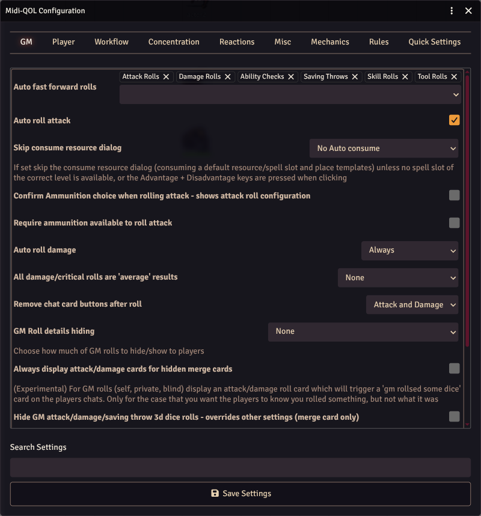  

**Rolling**

- **Auto fast forward rolls**: A multi-select field that lets you choose which roll types skip the configuration dialog. Options: Attack Rolls, Damage Rolls, Ability Checks, Saving Throws, Skill Rolls, Tool Rolls.
- **Auto Roll Attack**: GM attack rolls will be auto-rolled.
- **Auto roll damage**:
  - *Never*: Damage must be manually rolled by pressing the damage button
  - *Always*: Damage will always be rolled if an item has a damage roll (but won't be applied if it shouldn't be)
  - *Saving Throw Only*: "Other Formula" damage will be automatically rolled when normal damage is manually rolled
  - *Damage Roll Needed*: Damage will be rolled when it "should" be (e.g. an enemy is hit by an attack)
- **All damage/critical rolls are 'average' results**: Monster statblocks often say "7 (1d8 + 3) damage" - this option takes the average instead of rolling. Options: None, NPC only, PC only, All.

**Resources & Ammunition**

- **Skip Consume resource dialog**:
  - *No Auto consume*: Default - always shows the dialog
  - *Auto consume spell slot*: Spell slots consumed without prompting
  - *Auto consume resources/uses*: Limited use items consume without prompting
  - *Auto consume resources/spell slots*: Both of the above
- **Confirm Ammunition choice when rolling attack**: Shows the attack configuration dialog when ammunition is involved, letting you choose which ammo to use.
- **Require ammunition available to roll attack**: Prevents rolling an attack if no valid ammunition is available.

**Chat Card Display**

- **Remove chat card buttons after roll**: Which buttons to remove from the chat card after the roll is done.
- **Chat card summaries**: Whether a card's saving throws are folded into it (midi's saves section or dnd5e's summaries) or shown as separate messages. Options: *Each user's choice* (each user's dnd5e *Summarize chat cards* decides), *Always*, *Never*

**GM Roll Hiding**

- **GM Attack Roll Display**: What players see of GM attack rolls. Options: *Full Roll*, *Hide Formula*, *D20 Only*, *Attack Total Only*, *Hit/Miss Only*, *Hit/Miss/Critical/Fumble*, *Hidden*. A second choice sets what Dice So Nice shows them: *Show Dice*, *Ghost Dice* (the dice roll but their values are hidden) or *No Dice*.
- **GM Damage Roll Display**: The same for GM damage rolls. Options: *Full Roll*, *Damage Total Only*, *Hidden*, with the same Dice So Nice choice.
- **Show players when the GM rolls privately**: When the GM rolls with a private, self or blind roll mode, other players see a 'rolled some dice' stand-in instead of nothing.
- **Add fake dice to GM Dice So Nice rolls**: Add additional "decoy" dice so players can't count dice to work out modifiers.

**Other**

- **Preferred GM**: Choose which GM should handle socket calls. If 'none' the first GM on the current scene will be used.

##### Player Tab
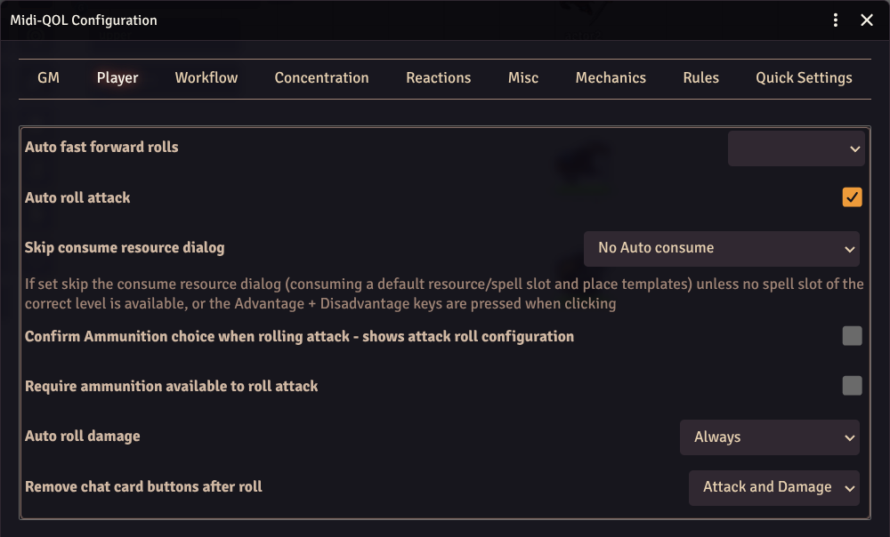

Similar to the GM tab but applies for non-GM players, with a smaller set of options. The same settings apply to all players. Settings include Auto fast forward rolls, Auto roll attack, Skip consume resource dialog, Confirm Ammunition choice, Require ammunition available, Auto roll damage, and Remove chat card buttons after roll.

#### Configuring the workflow.
Midi has the concept of a workflow: when you start the attack/cast the spell, midi goes through a set of steps to determine the outcome of the roll, starting with targeting and finishing with applying status conditions (like poisoned).
The workflow tab allows you to configure how each of those steps are performed and if they are automated or not. The tab is divided into five sections: Targeting, Specials, Hits, Saves, and Damage.

#### Configure targeting
Midi expects you to target who you want to hit before clicking the weapon/spell you want to attack with. This can be tedious for Area of Effect Spells (fireball) or Ranged Spells (Mass Healing Word). Midi can automate targeting for those spells if you wish.  

As players have been known to forget to target when it is their turn and this results in having to target then roll again. Midi supports target confirmation, configurable per player, to present a dialog after you hit the roll item button.

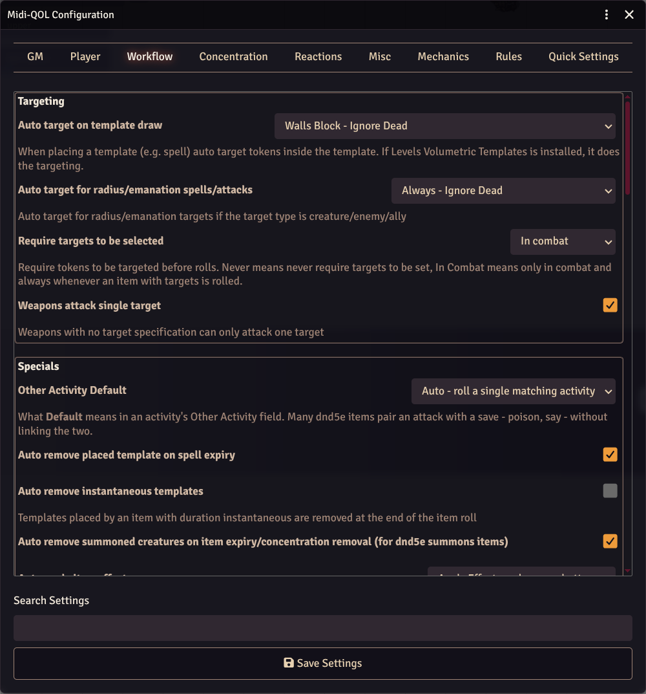

- **Auto target on template draw**: When placing a template (e.g. spell) auto target tokens inside the template. Options: *None*, *Always*, *Always - Ignore Incapacitated/Dead*, *Always - Ignore Dead*, *Walls Block*, *Walls Block - Ignore Incapacitated/Dead*, *Walls Block - Ignore Dead*, *Walled Templates*
- **Auto target for radius/emanation spells/attacks**: Auto target for radius/emanation targets if the target type is creature/enemy/ally. Same set of options as template targeting
- **Require targets to be selected**: Require tokens to be targeted before rolls. Options: *Never*, *In combat*, *Tokens in scene*, *Always*
- **Weapons attack single target**: Weapons with no target specification can only attack one target

#### Configure active effects (Specials)
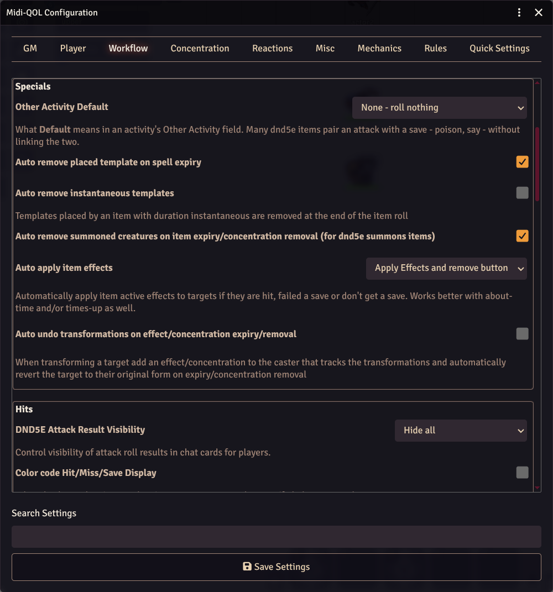

Often, an item will have an active effect on it which should be applied to the target of the item's use (for instance, a "bless" effect for the bless spell). By default, such an effect can only be applied by the GM. With midi, these can be set to auto-apply.

- **Other Activity Default**: Many items pair an attack with a save (poison, say) without linking the two. This sets what *Default* means in an activity's *Other Activity* field: *Auto - roll a single matching activity* (the save is rolled after the attack hits) or *None - roll nothing*.
- **Auto remove placed template on spell expiry**: Removes templates when the spell's effect expires
- **Auto remove instantaneous templates**: Templates placed by an item with duration instantaneous are removed at the end of the item roll
- **Auto remove summoned creatures on item expiry/concentration removal**: For dnd5e summons items, removes summoned creatures when the summoning effect ends
- **Auto apply item effects**: Automatically apply item active effects to targets if they are hit, failed a save, or don't get a save. Options: *Don't auto apply effects*, *Apply effects do not show button*, *Apply Effects and remove button*, *Apply effects but leave button*
- **Auto undo transformations on effect/concentration expiry/removal**: When transforming a target, add an effect/concentration to the caster that tracks the transformations and automatically reverts the target to their original form on expiry/removal
- **Apply Convenient Effects** (only shown if DFreds Convenient Effects is installed): Apply convenient effects which match activity name (if no match, item name) when item used. Requires auto apply active effects enabled. Options: *Only activity effects*, *Apply activity effects, if absent apply CE*, *Apply CE, if absent apply activity effects*, *Apply CE and activity effects*

#### Configure hits
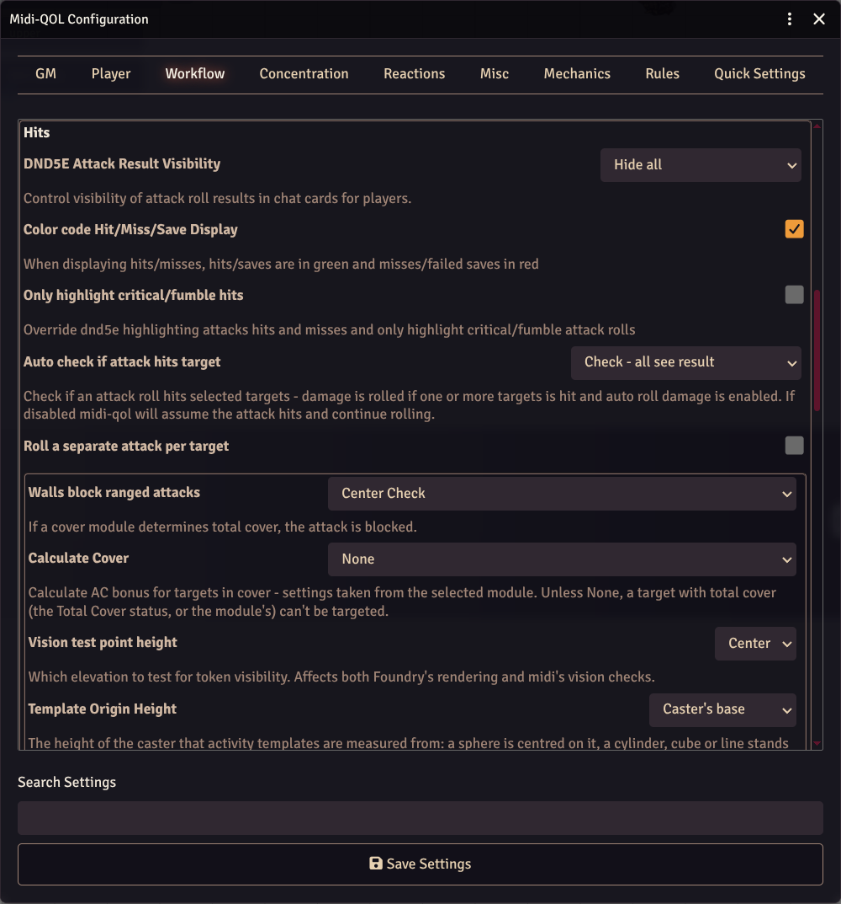

- **DND5E Attack Result Visibility**: Control visibility of attack roll results in chat cards for players. Options: *Show results & target ACs*, *Show only results*, *Hide all*
- **Color code Hit/Miss/Save Display**: When displaying hits/misses, hits/saves are in green and misses/failed saves in red
- **Only highlight critical/fumble hits**: Override dnd5e highlighting and only highlight critical/fumble attack rolls
- **Auto check if attack hits target**: Check if an attack roll hits selected targets. If disabled midi-qol will assume the attack hits and continue rolling. Options: *None*, *Check - all see result*, *Check - only GM sees results*, *Check - only GM sees anything*
- **Roll a separate attack per target**: When targeting multiple creatures with an attack-rolling item, roll a separate attack for each
**Walls, cover and vision**
- **Walls block ranged attacks**: If a wall that blocks movement, or a cover module, gives total cover, the attack is blocked. Options: *No*, *Center Check*, *Levels Auto Cover*, *Simbul's Cover Calculator*, *Alternative Token Cover*, *Simple Cover 5e*
- **Calculate Cover**: Calculate the AC bonus for targets in cover. Options: *None*, *dnd5e cover status only* (the target's Half/Three-Quarters/Total Cover status) or a compatible cover module
- **Vision test point height**: Which elevation to test for token visibility. Options: *Center*, *Top*
- **Template Origin Height**: The height of the caster that activity templates are measured from: a sphere is centred on it, a cylinder, cube or line stands on it. Options: *Caster's base*, *Caster's top*, *Caster's eye level*. An activity can override this in its Region settings
- **Occlude upper floor surfaces** / **Dim lower floors through surface holes**: For multi-level scenes, how floors above and below are drawn when viewed from a lower or upper floor

#### Configure checking saves
Midi can automate the process of requesting and adjudicating saves.
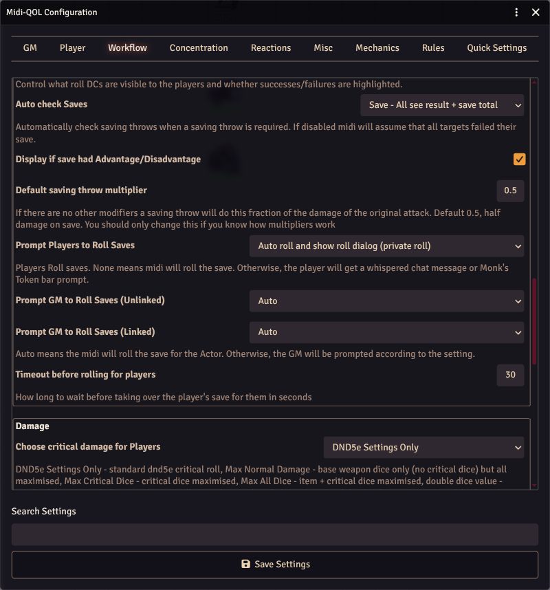

- **DND5E Challenge Visibility**: Control what roll DCs are visible to the players and whether successes/failures are highlighted. Options: *Show all*, *Show only from other players*, *Hide all*
- **Auto check Saves**: Automatically check saving throws when a saving throw is required. If disabled midi will assume that all targets failed their save. Options: *Off*, *Save - All see result only*, *Save - All see result + save total*, *Save - All see Result + Rolls*, *Save - only GM sees results + rolls*, *Save - only GM sees anything*
- **Save summary style**: With dnd5e's *Summarize chat cards* on, a card's saves are shown on the card rather than as separate messages. *midi saves section* (DC, success/failure and damage) or *dnd5e summaries*
- **Default saving throw multiplier**: If there are no other modifiers a saving throw will do this fraction of the damage of the original attack. Default 0.5 (half damage on save)
- **Prompt Players to Roll Saves**: How players will be prompted when they need to roll saves. Options:
  - *None (private roll)* / *None (public roll)*: Midi rolls the save automatically
  - *Auto roll and show roll dialog (public/private/self/blind roll)*: The player gets the roll dialog popped up on their screen immediately, with various visibility options
  - *Chat Message*: The player will be whispered the required save, and should then roll it themselves from their character sheet
  - *Monks Token Bar*, *Flash Token Bar*, *Rippers Epic Rolls*: Integration with third-party modules
  - Note that when testing, if no player is logged in and configured to be using an Actor as their main character, rolls against that actor will instead follow the "Prompt GM to Roll Saves (Linked)" setting
- **Prompt GM to Roll Saves (Unlinked/Linked)**: Similar to above but for GM-controlled actors, split between linked and unlinked tokens. Options: *Chat Message*, *Auto*, *Auto roll and show roll dialog*, *Monks Token Bar*, *Flash Token Bar*, *Rippers Epic Rolls*
- **Timeout before rolling for players**: How long to wait before taking over the player's save for them (in seconds)

#### Configure damage
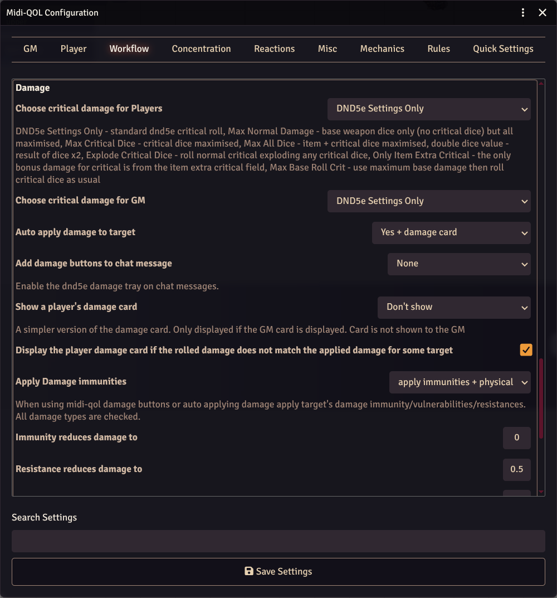

- **Choose critical damage for Players** / **Choose critical damage for GM**: How critical hit damage is calculated. These are separate settings for players and GM. Options: *DND5e Settings Only*, *Max Normal Damage*, *Max Critical Dice (flat number)*, *Max Critical Dice (roll dice)*, *Max All Dice*, *Double Rolled Damage*, *Explode all critical dice*, *Max base damage and explode critical dice*, *Explode Character critical dice*, *Explode NPC critical dice*, *Only Weapon Extra Critical*, *Max Base Roll Crit*, *Roll damage die twice and pick the highest*
- **Auto apply damage to target**: Whether to automatically apply damage to hit targets and whether to show a damage card. The "damage card" shows the total damage, the applied damage (after resistance/vulnerability/modification), and apply/undo buttons. Options: *No*, *No + damage card*, *No + damage card + misses*, *Yes*, *Yes + damage card*, *Yes + damage card + misses*, *Yes(NPC) No(PC) + damage card*
- **Show a player's damage card**: A simpler version of the damage card. Only displayed if the GM card is displayed. Options: *Don't show*, *Show player results*, *Show player results + buttons*, *Show player and npc results*, *Show player and npc + buttons*
- **Display the player damage card if the rolled damage does not match the applied damage for some target**: Shows a simpler damage card only when damage rolled is not equal to damage applied (e.g. due to resistance). This overrides the previous setting when checked

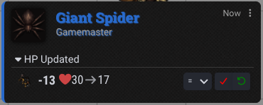

- **Apply Damage immunities**: When using midi-qol damage buttons or auto applying damage, apply target's damage immunity/vulnerabilities/resistances. Options: *Never*, *apply immunities*, *apply immunities + physical*
- **Immunity reduces damage to** / **Resistance reduces damage to** / **Vulnerability multiplies damage by**: The exact multipliers (defaults 0, 0.5 and 2)
- **Single Damage Calculation**: Calculate base, other and bonus damage in one pass, so damage modification and midi damage reduction are shared across all of an activity's damage rather than applied once per damage category
- **Damage Reduction Save Order**: Order in which damage reduction is applied. Options: *dm.midi/dnd5e.dm -> Saves/(dr/dv/di) - dnd5e RAW*, *Saves -> dm.midi/dm.dnd5e -> (dr/dv/di)*, *Saves -> dm -> (dr/dv/di) -> dm.midi*
- **Require 'Magical' property**: Controls whether items do magical damage by default. Options: *Off: Non-weapons do magical damage*, *Non spells do non-magical damage*, *All Items do non-magical damage*

#### Configure Concentration
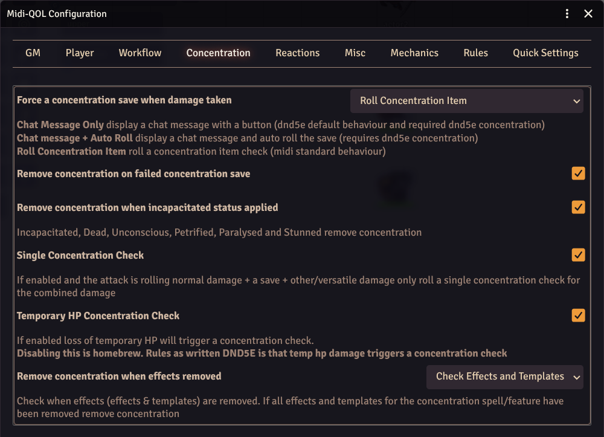

Midi-qol expands on the system's implementation of concentration. Settings include:
- **Force a concentration save when damage taken**:
  - *Never*: No concentration checks
  - *Chat Message Only*: Display a chat message with a button (dnd5e default behaviour)
  - *Chat Message + Auto Roll*: Display a chat message and auto roll the save
  - *Roll Concentration Item*: Roll a concentration item check (midi standard behaviour)
- **Remove concentration on failed concentration save**: As described
- **Remove concentration when incapacitated status applied**: Incapacitated, Dead, Unconscious, Petrified, Paralysed and Stunned remove concentration
- **Single Concentration Check**: Prevents the issue of an attack with save-attached damage prompting two concentration rolls rather than one
- **Temporary HP Concentration Check**: If enabled, loss of temporary HP will trigger a concentration check. Disabling this is homebrew; RAW dnd5e is that temp HP damage triggers a concentration check
- **Remove concentration when effects removed**: Check when effects (effects & templates) are removed. If all effects and templates for the concentration spell/feature have been removed, remove concentration. Options:
  - *Never*: Don't check
  - *Check Effects*: Remove concentration when all dependent effects are removed
  - *Check Effects and Templates*: Remove concentration when all dependent effects and templates are removed

#### Configure Reactions
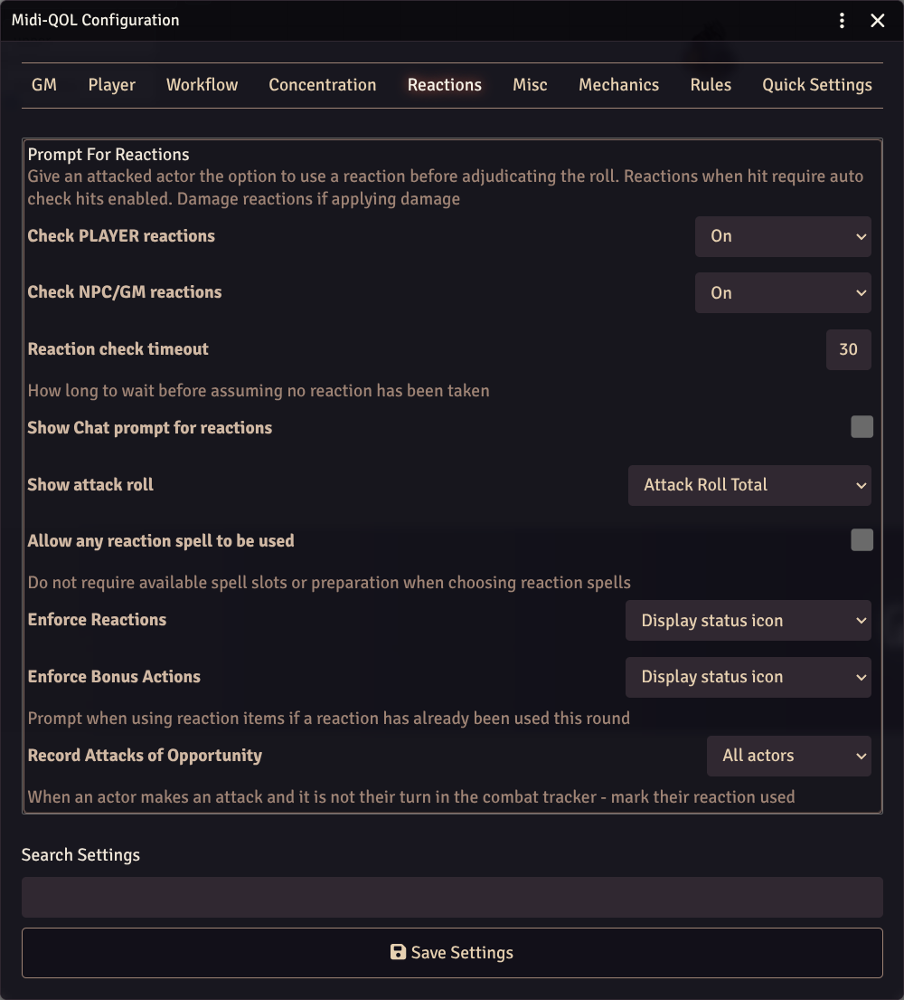

Midi-qol supports "reaction processing" — keeping track of reactions and auto-prompting for their use. The section header "Prompt For Reactions" groups the following settings:

- **Check PLAYER reactions**: Whether to prompt player reactions. Options: *On*, *On + Magic Items*, *off*
- **Check NPC/GM reactions**: Whether to prompt GM reactions. Options: *On*, *On + Magic Items*, *off*
- **Reaction check timeout**: How long (in seconds) to wait before assuming no reaction has been taken
- **Show Chat prompt for reactions**: Displays an auto-deleting message for the GM in chat when a reaction prompt is opened for a player
- **Show attack roll**: For reactions which prompt on being hit, what attack roll info to show in the prompt. Options: *Attack Hits*, *d20 roll*, *Attack Roll Total*, *Attack Roll Total + Critical*
- **Allow any reaction spell to be used**: Do not require available spell slots or preparation when choosing reaction spells
- **Enforce Reactions**: Track and optionally restrict reaction usage per round
  - *Do not check*: Reactions are not tracked in any way
  - *Display status icon*: Adds a "Reaction Used" status effect which is automatically applied when a reaction is used and removed on the start of an actor's turn
  - *Characters: prompt if used*: As above, but if a PC tries to use a reaction item, they'll receive a prompt telling them they've used their reaction already
  - *All actors: prompt if used*: As above, but for NPCs as well as PCs
- **Enforce Bonus Actions**: The same as above, but for Bonus Actions rather than Reactions
- **Record Attacks of Opportunity**: When an actor makes an attack and it is not their turn in the combat tracker, mark their reaction as used. Options: *Do not check*, *Characters only*, *All actors*

#### The "Misc" Tab
There are a lot of extra options that midi's got. The Misc tab covers chat card display, item sheet settings, and other miscellaneous options. The settings are grouped into several sections:

**Experimental & Export**
- **Roll saves before damage (Experimental)**: If enabled, saves are rolled before damage is rolled; otherwise saves are rolled after damage
- **Export/Import midi-qol settings**: Buttons to export settings to JSON or import from JSON

**Item Sheet & Activity Settings**
- **Activity Prefix**: Prefix midi-qol activity names with "Midi". Change requires reload
- **Condition Editor**: Show condition editor button on condition fields in activity sheets
- **Fill in missing rules text**: midi's sample items for content outside the SRD come without rules text. When one is added to an actor, midi copies the text from your official D&D modules (Player's Handbook, Tasha's…), the SRD, or a compendium of your own (*Rules text compendium* in the module settings)
- **Lowest User role for Item's properties**: Limits who can access the midi-qol properties based on user role
- **Add actor on use macro to sheet**: Enables midi's ability to have macros run at specified stages of a workflow attached to a specific actor
- **Add item on use macro to sheet**: Same but for items

**Chat Card Display**
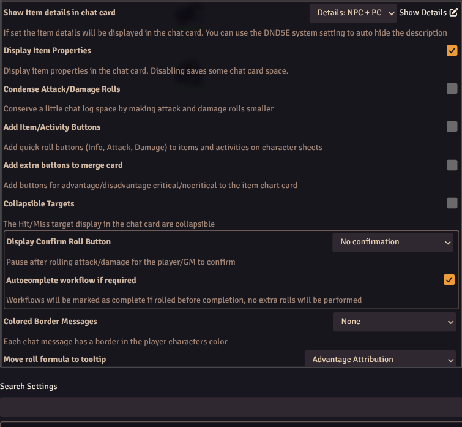

- **Show Item details in chat card**: Controls whether item details are displayed in chat cards. Options: *None*, *Card Only*, *Details: PC Only*, *Details: NPC + PC*
- **Display Item Properties**: Display item properties in the chat card. Disabling saves some chat card space
- **Condense Attack/Damage Rolls**: Conserve a little chat log space by making attack and damage rolls smaller
- **Add Item/Activity Buttons**: Add quick roll buttons (Info, Attack, Damage) to items and activities on character sheets
- **Add extra buttons to merge card**: Add buttons for advantage/disadvantage critical/no-critical to the item chat card
- **Collapsible Targets**: The Hit/Miss target display in the chat card are collapsible
- **Display Confirm Roll Button**: Pause after rolling attack/damage for the player/GM to confirm. Options: *No confirmation*, *Only GM can confirm*, *GM and Player can confirm*
- **Autocomplete workflow if required**: Workflows will be marked as complete if rolled before completion, no extra rolls will be performed
- **Colored Border Messages**: Each chat message has a border in the player character's color. Options: *None*, *Borders Only*, *Border + Name Text*, *Border + Name Background*
- **Move roll formula to tooltip**: Move the roll formula into the roll's expanded breakdown. The *Advantage Attribution* options are deprecated: the info icon on the roll's label shows the sources of advantage/disadvantage
- **Show Fast Forward**: Show Fast Forward indicator on attack and damage buttons

**Token & Portrait Settings**
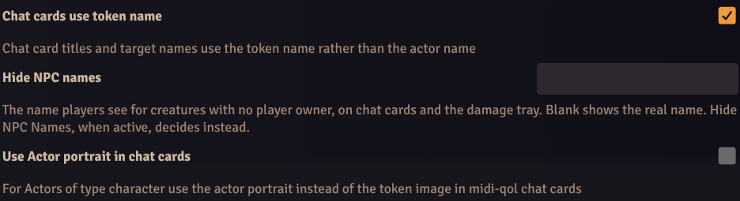

- **Chat cards use token name**: Chat card titles and target names use the token name rather than the actor name
- **Hide NPC names**: The name players see for creatures with no player owner, on chat cards and the damage tray. Blank shows the real name. If Hide NPC Names is active, that module decides instead
- **Use Actor portrait in chat cards**: For Actors of type character use the actor portrait instead of the token image in midi-qol chat cards

**Custom Sounds**
- **Enable midi-qol custom sounds**: If set will override system sounds. Configure sounds from the 'Configure Midi Custom Sounds' Application

#### The "Mechanics" Tab
For configuring gameplay mechanics:

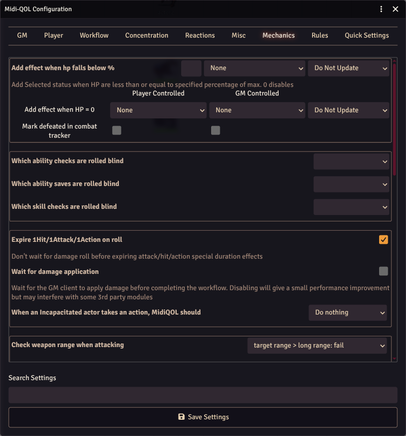

- **Add effect when hp falls below %**: Add a selected status when HP are less than or equal to a specified percentage of max. 0 disables. Choose the condition and whether to add it as an overlay or icon
- **Add effect when HP = 0**: As above, but for 0hp. Separate settings for Player Controlled and GM Controlled tokens. Options: *Do Not Update*, *Add effect as overlay*, *Add effect as icon*. Also includes a "Mark defeated in combat tracker" checkbox
- **Enforce death saves**: A character at 0 hit points that takes damage suffers a death saving throw failure, two from a critical hit, and three (death) if the damage equals or exceeds its hit point maximum. At three it is marked dead as for a failed death save; undo on the damage card restores the count and status
- **Which ability checks / ability saves / skill checks are rolled blind**: Three settings choosing which rolls are always blind (death saves included)
- **Blind roll display**: How those rolls appear to players: *Hidden* (players see nothing) or *Obscured* (the card is shown with the result as ??)
- **Expire 1Hit/1Attack/1Action on roll**: Don't wait for damage roll before expiring attack/hit/action special duration effects
- **Wait for damage application**: Wait for the GM client to apply damage before completing the workflow. Disabling gives a small performance improvement but may interfere with some 3rd party modules
- **Require no shield equipped for two-handed/off-hand attacks**: Prevents two-handed or off-hand attacks when a shield is equipped

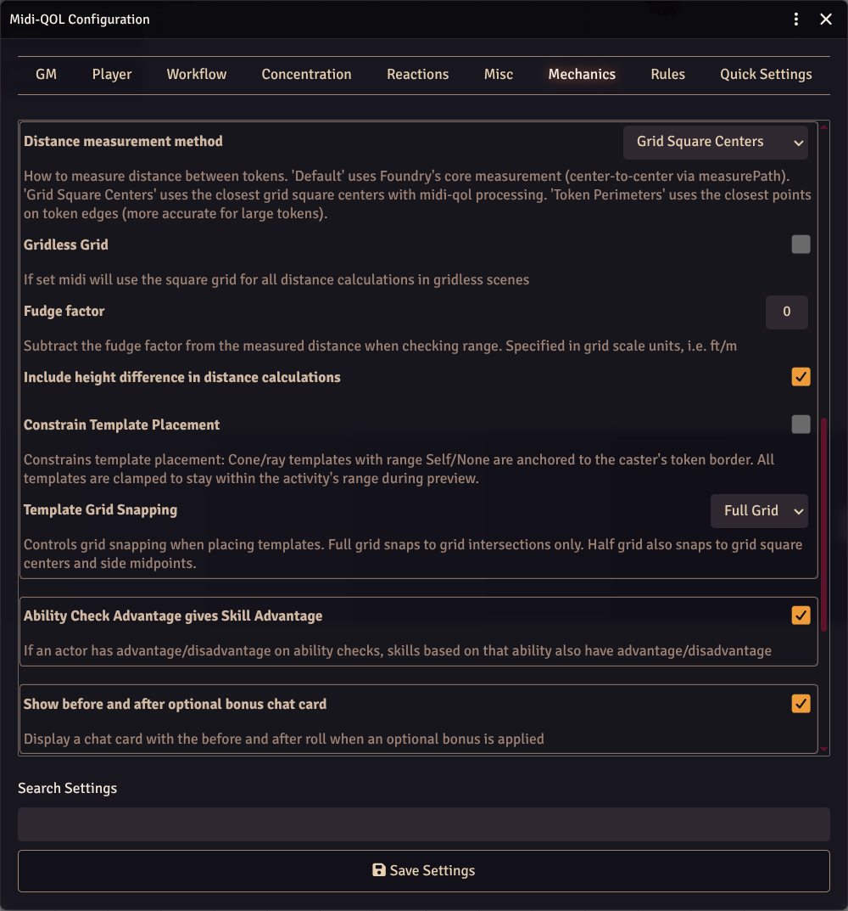

- **Distance measurement method**: How to measure distance between tokens. Default uses Foundry's core measurement. Grid Square Centers uses closest grid square centers. Token Perimeters uses closest points on token edges (more accurate for large tokens)
- **Gridless Grid**: If set, midi will use the square grid for all distance calculations in gridless scenes
- **Fudge factor**: Subtracted from measured distances when checking range, on every grid type (in grid scale units). Edge-to-edge token distances never drop below one grid unit
- **Include height difference in distance calculations**: As described
- **Mounted creatures use their mount's space**: A rider's range and reach, and distances to it, are measured from its mount's space. Riders are marked by the Rideable module (familiars riding their master too; grappled tokens keep their own space), or by setting `flags.midi-qol.mount` on the rider's token to its mount's token id. Cover still comes from your cover module, which checks the rider's own token.
- **Constrain Template Placement**: Constrains template placement — cone/ray templates with range Self/None are anchored to the caster's token border. All templates are clamped to stay within the activity's range during preview
- **Template Grid Snapping**: Controls grid snapping when placing templates. *Full grid* snaps to grid intersections only. *Half grid* also snaps to grid square centers and side midpoints
- **Show before and after optional bonus chat card**: Display a chat card with the before and after roll when an optional bonus is applied
- **Auto reroll initiative**: Auto reroll initiative for all combatants at the start of a new round. Warning: can break round/turn effect expiry
- **Support undoing item rolls**: If enabled midi will store undo data for all item/activity rolls. Undo via `MidiQOL.undoMostRecentWorkflow()`
- **Undo Chat Cards Color**: What to do with chat cards from undone rolls (Delete or recolor)
- **Activation Cost Automation**: Automatically activate activities with short/long rest or encounter start or turn start/end activation costs. Options: *No Automation/No Chat*, *Default dnd5e behavior*, *Auto trigger self targeted activities*

#### The "Rules" Tab
For configuring optional game rules:

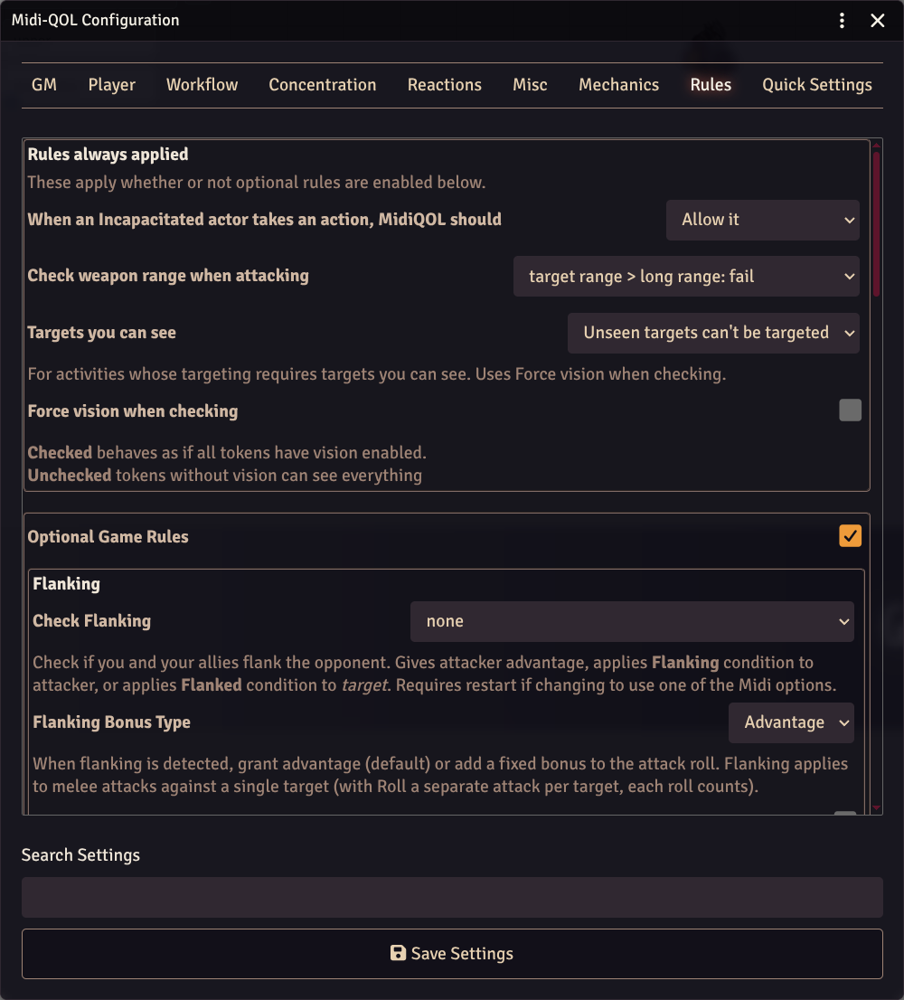

- **When an Incapacitated actor takes an action**: Options: *Do nothing*, *Enforce no actions*, *Post a warning only*
- **Check weapon range when attacking**: Options: *Do not check range*, *target range > long range: fail*, *target range > long range: disadvantage*
- **Targets you can see**: For activities whose targets must be creatures you can see. Options: *Do not check*, *Unseen targets can't be targeted*, *Post a warning only*
- **Force vision when checking**: Checked behaves as if all tokens have vision enabled. Unchecked means tokens without vision can see everything
- **Optional Game Rules**: This checkbox unlocks the optional rules below it. The *Rules always applied* box at the top of the tab (incapacitated actors, weapon range, targets you can see, force vision) applies whether or not it is ticked
- **Check Flanking**: Flanking rules! Options (in order):
  - *none*: No flanking rules
  - *Advantage Only*: No effect applied — flanking actor is simply given advantage on attacks against flanked target
  - *Convenient Effects Flanking*: Apply the CE 'Flanking' effect to the attacker only
  - *Midi Flanking effect*: Apply midi-qol's 'Flanking' effect to the attacker only
  - *Convenient Effects Flanked*: Apply the CE 'Flanked' effect to the target (all melee attackers benefit)
  - *Midi Flanked effect*: Apply midi-qol's 'Flanked' effect to the target (all melee attackers benefit)
  - *Convenient Effects Flanked + no conga line*: As above, but Flanked tokens cannot flank other tokens
  - *Midi Flanked + no conga line*: As above, but Flanked tokens cannot flank other tokens
- **Flanking Bonus Type**: When flanking is detected, grant advantage (default) or add a fixed bonus (+1 to +5) to the attack roll. Flanking applies to melee attacks against a single target
- **Flanking requires target can sense flanker**: An ally only counts as a flanker if the target can sense them, so invisible or hidden allies don't help
- **Show Flanking Positions**: Highlight grid cells where an ally would create flanking against your current target
- **Unseen/Invisible attackers have advantage/disadvantage on attacks**: Options:
  - *Do not apply*
  - *RAW (2014)*: Invisible condition always grants adv/disadv; other senses (blindsight, tremorsense) negate unseen adv/disadv
  - *RAW (2024)*: Only grants adv/disadv if the other creature cannot _see_ you — blindsight/truesight negate, but tremorsense does not
  - *Use Token Vision*: Invisible attackers have advantage on targets who can't see them
- **Hidden attackers have adv/disadv on attacks**: How a creature with the Hiding condition (the Hide action) is treated. Options: *Do not apply*, *Hiding is Invisible to whoever doesn't perceive it* (it is Invisible, on the map and in the unseen attacker/target rules, to each creature that doesn't perceive it), *As above, and a passive Perception at least the hide's DC perceives it* (house rule), *Perceptive* (the Perceptive module decides who spots whom)
- **Apply condition rules**: Applies the condition rules dnd5e doesn't: attacks by a frightened, poisoned, prone or restrained creature have disadvantage; attacks against a paralyzed, petrified, restrained, stunned or unconscious creature have advantage (prone: advantage within 5 ft, disadvantage beyond); hits within 5 ft on a paralyzed or unconscious creature are critical; paralyzed, petrified, stunned and unconscious creatures fail Strength and Dexterity saves; frightened creatures have disadvantage on ability checks; silenced creatures can't cast spells with a verbal component. Grappled is not included
- **Ranged attacks when a foe is closer than this have disadvantage**: 0 disables
- DR-related house rules (grouped in a box):
  - *Only most effective DR applies*: Enabling means only the most effective Damage Reduction will apply. Off means DR accumulates
  - *DRALL deducted from BOTH attack and Other damage*: Unchecked means DRALL applies just once to the total damage

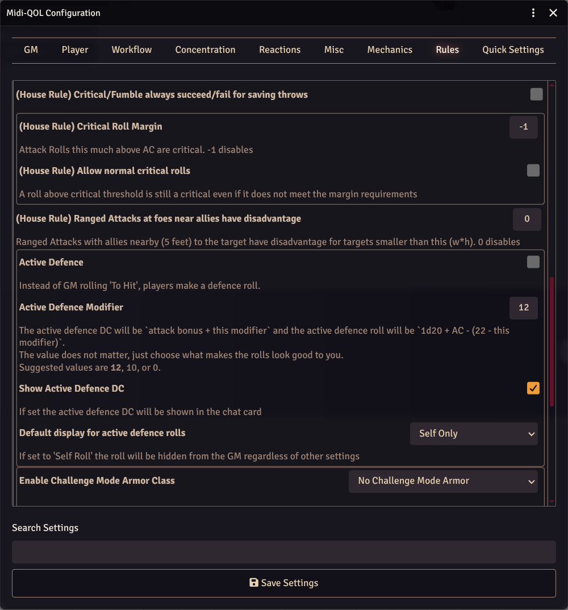

- **Critical/Fumble always succeed/fail for saving throws**: House rule
- **Critical Roll Margin**: Attack rolls this much above AC are critical. -1 disables
- **Allow normal critical rolls**: With a critical margin set, a roll in the critical range is still a critical even if it doesn't beat AC by the margin
- **Ranged Attacks at foes near allies have disadvantage**: Ranged attacks with allies nearby (5 feet) to the target have disadvantage for targets smaller than a specified size. 0 disables
- **Active Defence**: Instead of GM rolling 'To Hit', players make a defence roll. Sub-settings:
  - *Active Defence Modifier*: The DC will be `attack bonus + modifier` and roll will be `1d20 + AC - (22 - modifier)`. Suggested values: 12, 10, or 0
  - *Show Active Defence DC*: Whether the DC is shown in the chat card
  - *Default display for active defence rolls*: Roll visibility mode (public, private, blind, self)
- **Enable Challenge Mode Armor Class**: Implements challenge mode armor rules (see the readme for details). Options: *No Challenge Mode Armor*, *Challenge Mode Armor (Base)*, *Challenge Mode Armor (Scaled)*, *Challenge Mode Armor (Scaled No AR)*
- **Vitality Item**: Set to the exact name of an item with uses (case-sensitive). Damage applied to a target with 0 HP reduces the item's uses. When the item's uses reach 0 the target is dead. Sub-settings:
  - *Vitality Exhausted Condition*: The condition to apply when vitality reaches 0 (defaults to 'Dead')
  - *Vitality Death Requires*: Options: *Vitality of 0*, *Vitality of 0 AND HP of 0*

#### The "Quick Settings" Tab
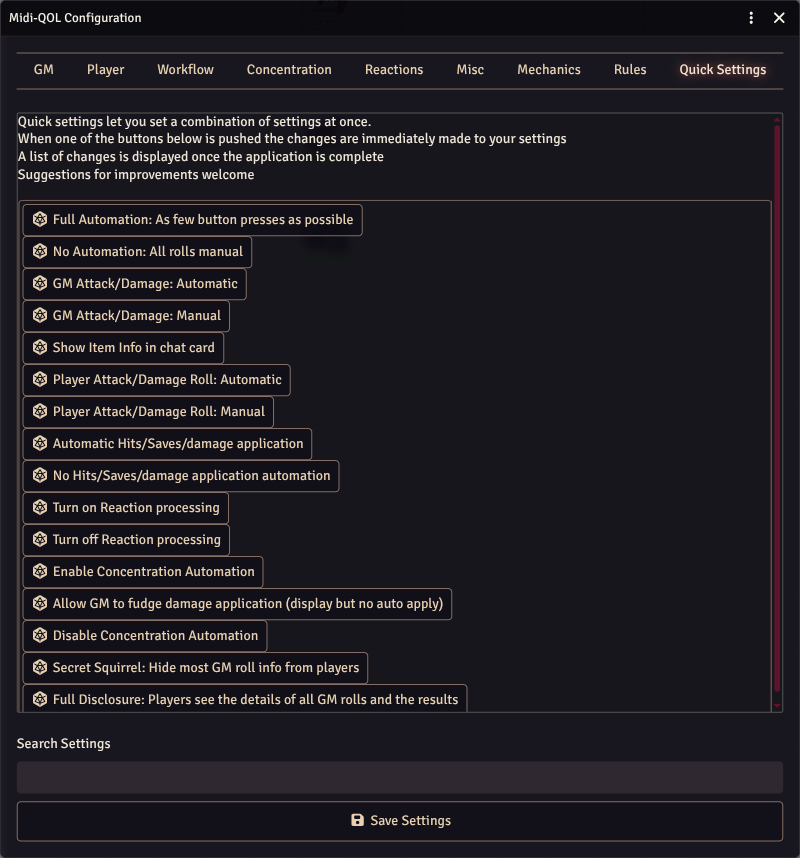

If you've made it this far, you really don't need to use this tab! It exists to give users a "jumping off" point of settings they might like. Quick settings let you set a combination of settings at once by pressing a single button. Options include:
- Full Automation / No Automation
- GM Attack/Damage: Automatic / Manual
- Player Attack/Damage Roll: Automatic / Manual
- Show Item Info in chat card
- Automatic Hits/Saves/damage application / No automation
- Turn on/off Reaction processing
- Enable/Disable Concentration Automation
- Allow GM to fudge damage application (display but no auto apply)
- Secret Squirrel: Hide most GM roll info from players
- Full Disclosure: Players see the details of all GM rolls and the results

## Now What
Once you have configured combat to work the way you want, simple combats should work with automation — checking hits, rolling and applying damage using the standard SRD weapons. Spells that do damage/healing should also work with no further changes.

Beyond that, people want to apply "Active Effects" to themselves or the targets to handle spell/feature effects.

To do that you will need to get items that are set up to work with midi-qol's automation and effect application.

There are quite a few sources of items and there are certainly others I am not aware of. Creating your own is doable, but sometimes a little complicated.
#### Sources of items
* **The SRD compendiums** A growing number of items in the SRD compendiums come with active effects pre-defined. These are always configured as "transfer effects" which means the effect is created on the actor that has the spell/item. This is usually NOT what you want for use with midi-qol for spells/items.  Simple spells/items can be made usable in midi-qol by changing the effect to no longer has transfer to actor when equipped disabled. The Bless spell is a good example.

* **Midi Sample Items Compendium** A small number of items/spells/features are provided in the sample item's compendium. They are intended to showcase techniques you can use to create your own effects.

* **Cauldron of Plentiful Resources (CPR)**

* **D&D Beyond Importer (DDBi)**

* **Gambit's Premades (GPS)**

* **Midi Item Showcase Community (MISC)**

* **@Crymic** is creating lots of spell/item/feature effects. Access requires patreon support but there are many features available.

* **Modules worth mentioning for homebrew Items/rules**
  * **Bossloot Magic Items** (free and patreon versions)

  * **Elkan 5e**

  * **Shayne's Box of Everything**

  * **Stroud's DnD Helpers**

* **Others I don't know about**. Probably many.

### There is nothing I can find that does what I want....
If you get to this point then you'll have to create your own item. There are no definitive rules for how to do this. In combination midi-qol/DAE give you quite a lot of tools to implement what you need.
Here is a simple check list to get you started.
* Does the effect apply to a character when it is in their inventory? Example: Cloak of Protection.
Then you probably want a "transfer" (or passive) effect ("Apply Effect to Actor" checked in the effect details page). The effect is transferred from the item to the actor that has it in their inventory. Dnd5e checks for attunement and if the item is equipped for the effect to be active. 
  - Cloak of Protection. Grab the SRD Cloak of Protection and import it. 
  - Edit the cloak and click on the effects tab, then click on the edit icon next to the single Cloak of Protection effect.
  - You will see in the effect editor details tab that it is a transfer effect and on the Changes tab it adds 1 to AC, and adds 1 to saving throws.
  - Add the item to a character.
  - You will that the item has "requires attunement" - you will need to change this to attuned for the item to apply it's effects.
  - The item is not equipped and you will need to equip it for the effects to apply.
  Once doing all of that the AC of the character goes up by 1 and the saves all go up by 1.
* Does the effect apply when I use the item?
If so you will need to set up non-transfer effects.
Let's do a very quick example using the SRD Bless spell. 
  - Import the spell into your world items and edit the effects from the effects tab. 
  - You will see that it is an inactive effect, and on the effects tab a number of bonuses are set to be applied.
  - Uncheck "Effect Suspended" in the details tab so that it is no longer inactive by default.
  - Ensure that "Auto apply item effects" is set to something besides "Don't auto apply effects" in the midi-qol settings workflow tab.
  - Add the spell to a character's spell book, target someone and cast the spell by clicking on the spell icon on the character sheet (the same as rolling any item).
  - Examine the target character's sheet and in the effects tab you will see that the bonus effects have been applied to the character, with the specified duration.

* An item target can be "self" targeting which always apply the effects to the caster.
* There are lots of spell/item/feature effects you can create with this simple model. Look at the DAE and midi-qol readme documents for a good chunk of DAE/midi-added fields you can use, check out [the dnd5e system wiki ](https://github.com/foundryvtt/dnd5e/wiki/Active-Effect-Guide) for many commonly used fields, and keep in mind that DAE makes many of the "Rolldata: No" fields accept Rolldata, and has a built-in field explorer which can aid in finding keys.

If you can't get what you want from the "standard" effects you might be able to use some of midis more complex effects.

### Midi-qol special active effects
Midi defines lots of flags that can affect how combat is adjudicated, for example granting advantage or disadvantage. Please see the readme for a list and explanation.
