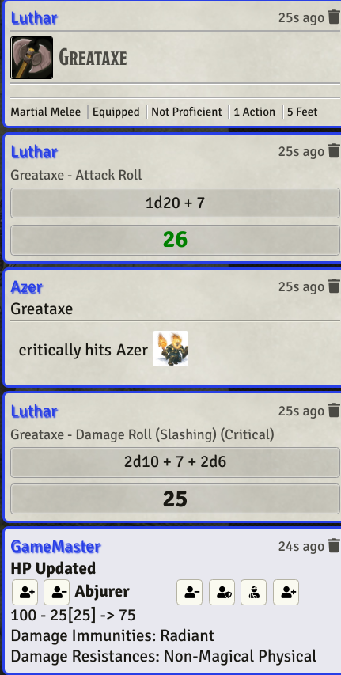
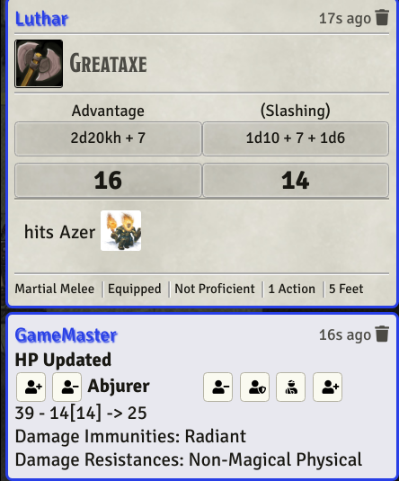

# Midi-QOL Macro Writing Guide

> [!tip] Navigation
> This document covers macro writing for midi-qol. For general module documentation, see [README.md](README.md).

## Table of Contents
- [Getting Started](#getting-started)
- [Triggering Workflows](#triggering-workflows)
- [MidiQOL API Functions](#midiqol-api-functions)
- [Hooks Reference](#hooks-reference)
- [Workflow Types](#workflow-types)
- [OnUse Macros](#onuse-macros)
- [Workflows and Chat Cards](#workflows-and-chat-cards)
- [Damage Bonus Macros](#damage-bonus-macros)
- [Macro Data Reference](#macro-data-reference)
- [Adding to Chat Cards (Card Notes)](#adding-to-chat-cards-card-notes)
- [Waiting on Players (Player Waits)](#waiting-on-players-player-waits)
- [DAE vs Midi-QOL Macros](#dae-vs-midi-qol-macros)
- [Tips and Tricks](#tips-and-tricks)
- [Sample Chat Logs](#sample-chat-logs)

## Other Pages

- [Flags](/FLAGS.md)
- [Flowchart](/docs/flowchart.md)
- [Getting Started](/Getting%20Started.md)
- [Readme](/README.md)
- [Workflow Fields](/docs/workflowfields-2026-10-30.md)

---

## Getting Started

For modules and macros that want to trigger midi-qol workflows, the recommended approach is to use `activity.use()`. This is the native dnd5e method that midi-qol intercepts to create its workflow.

### Key Accelerators

Roll keys follow dnd5e's keybindings (Configure Controls), and apply when you pass the triggering `event`:

| Key | Effect |
|-----|--------|
| Alt | Advantage, and skip the roll dialog |
| Ctrl | Disadvantage, and skip the roll dialog |
| Shift | Normal roll, skip the roll dialog |
| Shift+Alt / Shift+Ctrl / Shift+Alt+Ctrl | Force advantage / disadvantage / a normal roll |
| F (midi's *Roll Toggle*) | Invert whether the roll dialog shows, and whether damage is rolled automatically |
| V (midi's *Versatile*) | Roll a versatile weapon two-handed |

### Legacy Support
- `item.roll()` no longer exists in dnd5e 6: use `activity.use()`, `item.use()` or `MidiQOL.completeActivityUse()`.
- `MidiQOL.applyTokenDamage` is exported.
- `MidiQOL.applyTokenDamageMany` is exported: it applies different damage amounts per target, with a single damage card.

### Roll Complete Hooks
If you have macros that depend on being called when the roll is complete:
- `"midi-qol.RollComplete"`
- `"midi-qol.RollComplete.ItemUuid"` (where ItemUuid is the uuid of the item doing the roll)

---

## Triggering Workflows

### activity.use() (Recommended)

The primary way to trigger a midi-qol workflow is via the dnd5e `activity.use()` method. Midi-qol intercepts this call to create its workflow. `activity.use()` resolves as soon as the use has started; to wait for the whole workflow, use `MidiQOL.completeActivityUse()` (below).

```js
// Get an activity from an item
const item = actor.items.getName("Longsword");

// Get first activity
const activity = item.system.activities.contents[0];

// Or get by activity ID
const activityById = item.system.activities.get("dnd5eactivity000");

// Or get activities by type (returns array)
const attackActivities = item.system.activities.getByType("attack");
const saveActivities = item.system.activities.getByType("save");

// Or find by custom predicate
const namedActivity = item.system.activities.find(a => a.name === "Main Attack");

// Basic usage - triggers midi-qol workflow
await activity.use();

// With configuration options
await activity.use(
  {
    // ActivityUseConfiguration
    consume: { resources: true, spellSlot: true },
    spell: { slot: "spell3" }, // cast a spell with a 3rd level slot
  },
  {
    // RollDialogConfig
    configure: false, // Skip configuration dialog
  },
  {
    // RollMessageConfig
    create: true, // Create chat message
  }
);
```

**ActivityUseConfiguration options:**
| Option | Type | Description |
|--------|------|-------------|
| `consume.resources` | boolean \| number[] | Consume item resources (or the consumption targets with these indices) |
| `consume.spellSlot` | boolean | Consume spell slot |
| `spell.slot` | string | The spell slot to cast with, e.g. `"spell3"`, `"pact"` |
| `scaling` | number | Levels above the base level, for non-spell scaling (spells take theirs from `spell.slot`) |
| `midiOptions` | object | Midi-specific options (see below) |

**Midi-specific options (in `midiOptions`):**
| Option | Type | Description |
|--------|------|-------------|
| `advantage` | boolean | Force advantage on attack |
| `disadvantage` | boolean | Force disadvantage on attack |
| `fastForward` | boolean | Skip roll dialogs |
| `fastForwardAttack` | boolean | Fast forward attack roll only |
| `fastForwardDamage` | boolean | Fast forward damage roll only |
| `isCritical` | boolean | Force critical hit |
| `spellLevel` | number | Cast a spell at this level without spending a slot (scales its damage and effects) |
| `rollAs` | Actor | Use the activity as if this actor used it |
| `targetsToUse` | Set<Token> | The targets for this use, instead of the user's targets |
| `workflowOptions` | object | Additional workflow options (see below) |

`targetUuids`, `ignoreUserTargets`, `asUser`, `checkGMstatus`, `activityId` and `activityIdentifier` are read only by `MidiQOL.completeActivityUse` / `MidiQOL.completeItemUse` (below): a plain `activity.use()` ignores them.

**WorkflowOptions (in `midiOptions.workflowOptions`):**

Leave an option out and the midi-qol configuration panel's setting applies.

| Option | Type | Description |
|--------|------|-------------|
| `allowIncapacitated` | boolean | Allow use while incapacitated |
| `autoRollAttack` | boolean | Auto roll the attack |
| `autoFastAttack` | boolean | Fast forward the attack roll |
| `autoRollDamage` | string | `"always"`, `"onHit"`, `"saveOnly"` or `"none"` |
| `fastForwardDamage` | boolean | Fast forward the damage roll |
| `isReaction` | boolean | Record the use as a reaction (for undo) |
| `noConcentrationCheck` | boolean | Skip concentration check |
| `noOnUseMacro` | boolean | Skip onUse macros |
| `noProvokeReaction` | boolean | Don't provoke reactions |
| `noTargetOnUseMacro` | boolean | Skip target onUse macros |
| `targetConfirmation` | string | `"always"` to always confirm targets, `"none"`/`"never"` to skip confirmation; anything else follows the settings |

**Example - Triggering with specific targets:**
```js
const item = actor.items.getName("Fireball");
const activity = item.system.activities.contents[0];

// By token: activity.use takes a set of tokens
await activity.use({
  midiOptions: { targetsToUse: new Set([target1, target2]) }
}, { configure: false }, { create: true });

// By uuid, waiting for the whole workflow
await MidiQOL.completeActivityUse(activity, {
  midiOptions: { targetUuids: [target1.document.uuid, target2.document.uuid] }
}, { configure: false }, { create: true });
```

### item.use() (Alternative)

You can also trigger via the item. With several usable activities midi shows its activity choice dialog (with a roll key held, it takes the attack activity, else the first); with none, it posts the item's card.

```js
const item = actor.items.getName("Longsword");
await item.use();

// With options
await item.use({
  midiOptions: { advantage: true }
}, { configure: false });
```

---

## MidiQOL API Functions

### completeActivityUse (Recommended)

```js
async MidiQOL.completeActivityUse(activity, usage, dialog, message)
```

Uses the activity and resolves when its midi-qol workflow has finished, with the workflow. This is the recommended API function for programmatic workflow triggering.

- It resolves with the workflow when the workflow has cleaned up (`midi-qol.postCleanup`), or has been aborted (`midi-qol.preAbort`): check `workflow.aborted`.
- It resolves with `undefined` if the use fails to start, if the workflow hasn't finished after 90 seconds, or for an activity midi doesn't run as a workflow.

**Parameters:**
| Parameter | Type | Description |
|-----------|------|-------------|
| `activity` | Activity \| string | Activity object or activity UUID |
| `usage` | ActivityUseConfiguration | Configuration options |
| `dialog` | ActivityDialogConfiguration | Dialog configuration |
| `message` | ActivityMessageConfiguration | Message configuration |

**Usage configuration (first parameter - dnd5e options):**
| Option | Type | Description |
|--------|------|-------------|
| `consume` | object\|false | Consumption settings, or false to skip consumption |
| `consume.action` | boolean | Consume the activation action |
| `consume.resources` | number[] | Array of consumption target indices to consume |
| `consume.spellSlot` | boolean | Consume a spell slot |
| `create` | object\|false | Creation settings, or false to skip creation |
| `create.measuredTemplate` | boolean | Create a measured template |
| `scaling` | number\|false | Levels above the base level, for non-spell scaling (spells take theirs from `spell.slot`), or false |
| `spell` | object | Spell-specific settings |
| `spell.slot` | string | Spell slot key (e.g., `"spell3"` for 3rd level slot) |
| `concentration` | object | Concentration settings |
| `concentration.begin` | boolean | Begin concentrating on this activity |
| `concentration.end` | string | ID of concentration effect to end |
| `cause` | object | Linked activity settings |
| `cause.activity` | string | Relative UUID of linked activity |
| `cause.resources` | boolean | Whether linked activity has resources |
| `subsequentActions` | boolean | Trigger subsequent actions (default: true) |
| `midiOptions` | object | Midi-specific options (see below) |

**Midi-specific options (in `usage.midiOptions`):**
| Option | Type | Description |
|--------|------|-------------|
| `advantage` | boolean | Force advantage on attack |
| `disadvantage` | boolean | Force disadvantage on attack |
| `fastForward` | boolean | Skip roll dialogs |
| `targetUuids` | string[] | Target these token UUIDs |
| `targetsToUse` | Set<Token> | Target these tokens |
| `ignoreUserTargets` | boolean | Don't fall back to the user's targets |
| `spellLevel` | number | Cast a spell at this level without spending a slot |
| `rollAs` | Actor | Use the activity as if this actor used it |
| `asUser` | User \| string | Run the use on this user's client |
| `checkGMstatus` | boolean | Non-GM clients hand roll to GM client |
| `workflowOptions` | object | Additional workflow processing options (see `activity.use()` above) |

**Dialog configuration (second parameter):**
| Option | Type | Description |
|--------|------|-------------|
| `configure` | boolean | Show the activity configuration dialog (default: true) |
| `applicationClass` | class | Custom dialog class to use (defaults to `ActivityUsageDialog`) |
| `options` | object | Options passed to the dialog application (position, display settings, etc.) |

**Dialog display options (in `options.display`):**
| Option | Type | Description |
|--------|------|-------------|
| `all` | boolean | Show all sections (default: true) |
| `scaling` | boolean | Show spell scaling section |
| `concentration` | boolean | Show concentration section |
| `consume` | boolean | Show consumption section |

**Message configuration (third parameter):**
| Option | Type | Description |
|--------|------|-------------|
| `create` | boolean | Create a chat message (default: true) |
| `data` | object | Data to merge into the chat message |
| `data.flags` | object | Flags to add to the message |
| `data.content` | string | Override the message content |
| `data.speaker` | object | Override the chat speaker |
| `rollMode` | string | Message mode (Foundry 14 names): `"public"`, `"gm"`, `"blind"`, `"self"`. The older names (`"gmroll"`…) silently fall back to the user's default |

**Example:**
```js
const item = actor.items.getName("Longsword");
const activity = item.system.activities.contents[0];

const workflow = await MidiQOL.completeActivityUse(activity, {
  midiOptions: {
    targetUuids: [targetToken.document.uuid],
    advantage: true
  }
}, { configure: false }, { create: true });

// workflow contains the completed midi-qol workflow
console.log(workflow.hitTargets); // Set of hit targets
```

**Example - Silent roll with custom roll mode:**
```js
const workflow = await MidiQOL.completeActivityUse(activity, {
  midiOptions: { fastForward: true }
}, {
  configure: false
}, {
  create: true,
  rollMode: "gm"  // Only visible to GM
});
```

**Example - No chat message:**
```js
const workflow = await MidiQOL.completeActivityUse(activity, {
  midiOptions: { targetUuids: [target.document.uuid] }
}, { configure: false }, { create: false });
```

### completeItemUse

```js
async MidiQOL.completeItemUse(item, config, dialog, message)
```

Uses one of the item's activities and resolves as `completeActivityUse` does. Which activity:
- `midiOptions.activityId`, or `midiOptions.activityIdentifier` (the activity's *Identifier* on midi's activity tab, else its name slugified, e.g. `"save"`);
- otherwise the only usable activity;
- with several, midi's activity choice dialog. With none, it posts the item's card and resolves with that message, not a workflow.

**Parameters:**
| Parameter | Type | Description |
|-----------|------|-------------|
| `item` | Item \| string | Item object or item UUID |
| `config` | ActivityUseConfiguration | Configuration options |
| `dialog` | RollDialogConfig | Dialog configuration |
| `message` | RollMessageConfig | Message configuration |

**Config options:**
| Option | Type | Description |
|--------|------|-------------|
| `chooseActivity` | boolean | Show activity selection dialog if multiple activities |
| `consume.resources` | boolean | Consume item resources |
| `consume.spellSlot` | boolean | Consume spell slot |
| `spell.slot` | string | The spell slot to cast with, e.g. `"spell3"` |

**MidiOptions (in `config.midiOptions`):**
| Option | Type | Description |
|--------|------|-------------|
| `activityId` | string | Use specific activity by ID |
| `activityIdentifier` | string | Use the activity with this identifier (or slugified name) |
| `checkGMstatus` | boolean | Non-GM clients hand roll to GM client |
| `targetUuids` | string[] | Target these token UUIDs instead of current targets |
| `ignoreUserTargets` | boolean | Ignore current user targets |
| `workflowOptions` | object | Additional workflow processing options |

**Example:**
```js
const item = actor.items.getName("Fireball");
const workflow = await MidiQOL.completeItemUse(item, {
  midiOptions: {
    targetUuids: [target1.document.uuid, target2.document.uuid]
  }
}, { configure: false }, { create: true });

// Use specific activity by identifier
const workflow2 = await MidiQOL.completeItemUse(item, {
  midiOptions: { activityIdentifier: "save" }
});
```

### canSee / canSense / canSenseModes

```js
MidiQOL.canSee(token, target, { forceVision })                    // boolean: sees by a sight-based sense
MidiQOL.canSense(token, target, validModes = ["all"], { forceVision })  // boolean: senses by any of validModes
MidiQOL.canSenseModes(token, target, validModes = ["all"], { forceVision }) // the detection modes that work
```

Whether `token` perceives `target`, with walls, lighting, levels and the token's detection modes. A token without vision enabled perceives everything (`["senseAll"]`) unless *Force vision when checking* is on or `forceVision: true` is passed, in which case it is checked as if its vision were enabled. The check never changes the token.

### getCoverBonus

```js
MidiQOL.getCoverBonus(attacker, target, activity?) // number
```

The AC bonus from cover midi applies to `target` against `attacker`: total cover if the target has the *Cover Total* status, otherwise the larger of the cover status bonus and the cover midi computes.

### highlightTokens

```js
const highlight = MidiQOL.highlightTokens(tokens, { color });
highlight.setActive(token); // pulse one token brighter; none when omitted
highlight.remove();
```

Pulsing rings around `tokens`, shown only on this client (e.g. the tokens a choice applies to). `color` defaults to the user's colour.

### reactionDialog

```js
async MidiQOL.reactionDialog(actor, triggerTokenUuid, reactionActivities, rollFlavor, triggerType, options)
```

Creates a dialog of activities the actor can use, each used by clicking its icon.

| Parameter | Type | Description |
|-----------|------|-------------|
| `actor` | Actor5e | The actor who will use the activity |
| `triggerTokenUuid` | string | UUID of the target token |
| `reactionActivities` | Activity[] | The activities to offer |
| `rollFlavor` | string | Text/HTML for dialog context |
| `triggerType` | string | Not relevant |
| `options` | object | `timeout` (seconds), and options merged over the use options midi builds |

### Moving tokens

```js
await MidiQOL.moveToken(token, { x, y, elevation?, level? }, options?)            // to a centre point
await MidiQOL.moveTokenAwayFromPoint(token, distance, { x, y }, options?)         // push away from a point
await MidiQOL.teleportToken(token, { x, y, elevation?, sceneUuid? })              // instant, optionally to another scene
```

All three run on the GM's client, so players can move tokens they don't own. `token` is a token, token document or uuid; points are canvas pixels (centres), `distance` and `elevation` grid units. `moveToken`'s `level` moves the token to another level of a multi-level scene.

| Option (`moveToken`, `moveTokenAwayFromPoint`) | Description |
|---|---|
| `animate` | Animate the move (default true) |
| `teleport` | Instant, ignoring walls and tokens |
| `ignoreWalls` / `ignoreTokens` | Move through walls / other tokens |
| `autoRotate` | Turn the token to face the way it moves |

### Effects on actors you don't own

```js
await MidiQOL.createEffects({ actorUuid, effects: [effectData], options: { keepId: true } });
await MidiQOL.updateEffects({ actorUuid, updates: [{ _id, ...changes }] });
await MidiQOL.removeEffects({ actorUuid, effects: [effectId] });   // a status id ("prone") removes that status
```

Run on the GM's client, so a player's macro can change a target's effects.

### Reactions, bonus actions and actions

```js
MidiQOL.hasUsedReaction(actor)        MidiQOL.hasUsedBonusAction(actor)        MidiQOL.hasUsedAction(actor)
await MidiQOL.setReactionUsed(actor)  await MidiQOL.setBonusActionUsed(actor)  await MidiQOL.setActionUsed(actor)
await MidiQOL.removeReactionUsed(actor, force?)   await MidiQOL.removeBonusActionUsed(actor, force?)   await MidiQOL.removeActionUsed(actor)
```

The markers midi uses to enforce *Enforce reactions* / *Enforce bonus actions* (the action marker is a flag on the actor, so `setActionUsed` needs an owner of the actor). They expire on their own (turn start, combat end, rests); remove one by hand only when your automation refunds the action.

### Distance, cover and visibility

```js
MidiQOL.getDistance(t1, t2, { wallsBlock?, includeCover?, includeElevation? })   // number, -1 if invalid or (wallsBlock) blocked
MidiQOL.checkDistance(t1, t2, distance, { wallsBlock?, includeCover? })          // boolean: within distance
MidiQOL.computeCoverBonus(attacker, target, activity?, { position? })            // AC bonus from cover
MidiQOL.unseenTargets(activity, token, targets)        // the targets token can't see
MidiQOL.totalCoverTargets(activity, token, targets)    // the targets in total cover from token
```

`getDistance` measures as midi does for range checks: the *Distance measurement method* setting, and height when *Include height difference* is on (unless `includeElevation` says otherwise). See also `canSee`, `canSense` and `getCoverBonus` above.

### Concentration and dependents

```js
MidiQOL.getConcentrationEffect(actor, item?)           // the actor's concentration effect (for item, if given)
await MidiQOL.doConcentrationCheck(actor, saveDC)       // ask for a concentration save
await MidiQOL.addConcentrationDependent(actor, document, item?)   // document is deleted when that concentration ends
await MidiQOL.addDependent(document, dependent)         // dependent is deleted when document is
```

Dependents are dnd5e's: an effect, template, region or item created by a spell can be tied to the caster's concentration or to another document.

### Conditions

```js
const data = MidiQOL.createConditionData({ workflow?, actor?, item?, activity?, target?, extraData? });
const result = await MidiQOL.evalCondition(conditionString, data);
const values = MidiQOL.evalAllConditions(actor, "flags.midi-qol.someFlag", data);
```

The data midi's activation and effect conditions see (`workflow`, `item`, `activity`, `target`, `raceOrType`, the actor's roll data…). Add your own with the `midi-qol.conditionData` hook, given the condition data and what it was built from: `Hooks.on("midi-qol.conditionData", (conditionData, input) => { conditionData.myValue = … })`.

### Players and tokens

```js
MidiQOL.playerFor(token)          // the user who controls the token (an active owner, else the GM)
MidiQOL.playerForActor(actor)
MidiQOL.getTokenForActor(actor)   // the actor's token on the scene, creating a temporary one if needed
MidiQOL.getTokenPlayerName(token) // the token's name as players are shown it (see also MidiQOL.tokenName)
```

### Dice So Nice and undo

```js
await MidiQOL.displayDSNForRoll(rolls, rollType, rollMode, saveDisplay?, actor?)   // show dice as midi does
await MidiQOL.undoMostRecentWorkflow()     // undo the last use (needs *Support undoing item rolls*)
await MidiQOL.removeMostRecentWorkflow()   // drop it from the undo queue without undoing
MidiQOL.showUndoQueue()
```

Pass the rolling actor to `displayDSNForRoll`, so Dice So Nice's *Hide NPC rolls* and *Disabled during combat* apply.

---

## Hooks Reference

The passed workflow is "live" so changes will affect subsequent actions. `preAttackRoll` and `preDamageRoll` will affect the roll about to be done.

**Workflow Hooks:**
| Hook | Returns | Description |
|------|---------|-------------|
| `midi-qol.preTargeting` | boolean | Before targeting, with `{ activity, token, config, dialog, message }` (no workflow yet). Return false to abort. |
| `midi-qol.preTargetingV2` | boolean | As preTargeting, with `{ workflow, usage, dialog, message }`. |
| `midi-qol.preItemRoll` | boolean | Before the use, with `{ activity, token, config, dialog, message }`. Return false to abort. |
| `midi-qol.preItemRollV2` | boolean | As preItemRoll, with `{ workflow, usage, dialog, message }`. |
| `midi-qol.preAttackRoll` | boolean | Before attack roll. Return false to abort. |
| `midi-qol.preAttackRollConfig` | boolean | Before attack roll configuration (after advantage/disadvantage). Return false to abort. |
| `midi-qol.preCheckHits` | void | Before checking hits |
| `midi-qol.hitsChecked` | void | After hits have been checked (only when *Auto check hits* is on) |
| `midi-qol.AttackRollComplete` | void | After attack roll complete |
| `midi-qol.preDamageRoll` | boolean | Before damage roll, with `(workflow, activity, config, dialog, message)`. Return false to abort. |
| `midi-qol.DamageRollComplete` | void | After damage roll complete |
| `midi-qol.preFormulaRoll` | boolean | Before utility formula roll. Return false to abort. |
| `midi-qol.preCheckSaves` | void | Before auto checking saves (only when *Auto check saves* is on) |
| `midi-qol.postCheckSaves` | void | After saves checked (only when *Auto check saves* is on) |
| `midi-qol.postActiveEffects` | void | After effects applied |
| `midi-qol.preTeleport` | boolean | Teleport activity (dnd5e 6): `(workflow, { maxDistance, tokens, movers })` before anyone moves. Change `tokens` to change who moves; return false to cancel. dnd5e's `dnd5e.preTeleport` fires first. |
| `midi-qol.postTeleport` | void | Teleport activity: `(workflow, results)` after the moves (each `{ token, plan, moved }`). |
| `midi-qol.RollComplete` | void | After workflow completed |
| `midi-qol.preAbort` | void | The workflow is being aborted |
| `midi-qol.postCleanup` | void | The workflow has finished and cleaned up (what `completeActivityUse` waits for) |
| `midi-qol.ReactionFilter` | async | `(reactions, options, triggerType, reactionActivityList)`: change the reactions offered; return false to offer none |

**State Hooks:**
Every workflow state also fires `midi-qol.pre<State>` before it and `midi-qol.post<State>` after it, e.g. `midi-qol.preWaitForSaves`, `midi-qol.postAttackRollComplete`, with the workflow. The states are the workflow's `WorkflowState_*` names (see Macro Passes below). Returning false from one ends the workflow (aborts it if `workflow.aborted` is set).

**Item/Activity-Specific Hooks:**
Workflow hooks also fire with an item or activity UUID suffix (not `ReactionFilter` or the damage calculation hooks):
- `midi-qol.preAttackRoll.{item.uuid}`
- `midi-qol.preAttackRoll.{activity.uuid}`
- `midi-qol.preAttackRollConfig.{item.uuid}`
- `midi-qol.preAttackRollConfig.{activity.uuid}`

Hooks that can cancel also fire with `.{workflow.id}`.

**Damage Calculation Hooks:**
| Hook | Returns | Description |
|------|---------|-------------|
| `midi-qol.dnd5ePreCalculateDamage` | boolean | Before damage calculation. Return false to abort. |
| `midi-qol.dnd5eCalculateDamage` | boolean | After damage calculation. Return false to cancel it. |

---

## Workflow Types

### TrapWorkflow

```js
new MidiQOL.TrapWorkflow(actor, activity, [targets], { x, y, direction?, removeDelay? })
```

Uses the activity (not the item) and applies its attack and/or damage to the passed targets. If the activity has an area template, it is placed at x,y (pointing in `direction`) and the targets in it are selected.

### DamageOnlyWorkflow

For applying damage outside of a normal item workflow.

```js
new MidiQOL.DamageOnlyWorkflow(
  actor,           // Actor doing the damage
  token,           // Token of the actor
  damageTotal,     // Total damage amount
  "damageType",    // Damage type (e.g., "radiant", "fire")
  targets,         // Array of target tokens
  damageRoll,      // The Roll object
  {
    flavor: "Description",
    itemCardUuid: workflow.itemCardUuid  // Optional: link to existing card
  }
)
```

### Attack per target

With *Roll a separate attack per target* (or an attack activity's *Attack Roll Per Target*), a use with several targets places its template, chooses its targets and spends its cost, then hands its attack to one use per target:
- Each target's use is a full workflow of its own, with one target and its own card linked to the first card. Its `workflowOptions.attackSplit` is `{ index, count, ammunition }`.
- The first use's macros and hooks before the attack run once; it rolls no attack, and its `RollComplete` comes after all the targets' uses.
- An onUse or RollComplete macro that should run once per use can check `workflow.workflowOptions.attackSplit`.

### DummyWorkflow

For calling workflow functions without a full workflow:

| Method | Description |
|--------|-------------|
| `async simulateAttack(target)` | Simulate the attack roll against `target`; sets `workflow.expectedAttackRoll` |
| `async simulateSave(targets)` | Simulate the targets' saves; sets `expectedSaveRoll` on each entry of `workflow.saveResults`, and returns the workflow |

Options `advantage`, `disadvantage` and `fastForward` are read from the constructor's options.

---

## OnUse Macros

Called during item workflow to customize behavior. Supports both item-based and actor-based macros.

### Specifying Macros

**On an item** (*On Use Macros* on the item sheet, `flags.midi-qol.onUseMacroName`): a comma-separated list of `[pass]name`, e.g. `[preAttackRoll]ItemMacro,[postActiveEffects]Macro.My Macro`.
- An entry without `[pass]` runs at `postActiveEffects`.
- A blank name is the item's own macro: the macro of the activity being used if it has one, else the item macro.
- An item's macro runs only from an onUse entry: with no entries it isn't run when the item is used.

**On an actor**, through an active effect:
```
flags.midi-qol.onUseMacroName | Custom | macroName,macroPass
```
- A blank name is the effect's activity macro, else its item's macro.
- An entry without a pass is ignored, and reported.

**Macro identifiers:**
| Identifier | Description |
|------------|-------------|
| `ItemMacro` | The used item's macro; in an effect change, the macro of the item the effect came from |
| `ItemMacro.uuid/name` | Macro on another item by uuid or name |
| `ActivityMacro` | The macro of the activity being used; in an effect change, the effect's activity (or, for a transfer effect, its item's first activity) |
| `ActivityMacro.uuid/id/name` | Activity macro by uuid, identifier, or name |
| `ActivityMacro-<id>` | The activity macro, run only when the activity being used has this id |
| `macro name` / `Macro.macro name` | World macro by exact name |
| `Compendium.<scope>.<pack>.Macro.<id>` | Compendium macro, by its UUID only |
| `function.functionName` | A global function, called with one object: `{ speaker, actor, token, character, item, rolledItem, macroItem, args, scope, workflow }` |

Add `|uuid` to a name to run it with that item, activity or effect's item as its context (`macroItem`, `macroActivity`).

### Macro Passes

> [!important] **Documentation:** A flowchart is available at [docs/flowchart.md](docs/flowchart.md).
> Data available at each pass: [docs/workflowfields-2026-10-30.md](docs/workflowfields-2026-10-30.md).

**Item/Actor passes:**
| Pass | Description |
|------|-------------|
| `preTargeting` | Before targeting. Return false to cancel the use |
| `preItemRoll` | Before item roll. Return false to cancel the use |
| `templatePlaced` | After template placed |
| `preAttackRoll` | Before attack roll |
| `preAttackRollConfig` | Before attack roll configuration |
| `preCheckHits` | After attack, before hit check |
| `postAttackRoll` | After attack adjudicated |
| `preDamageRoll` | Before damage roll |
| `preDamageRollConfig` | Before damage roll configuration. Return false to cancel the roll |
| `postDamageRoll` | After damage roll |
| `preSave` | Before saves rolled |
| `postSave` | After saves rolled |
| `damageBonus` | When computing damage bonus (item only; `macroPass` is `"DamageBonus"`) |
| `preDamageApplication` | Once per damaged target, before its damage is applied: change `workflow.damageItem` (that target's entry) |
| `preActiveEffects` | Before effects applied. Return `{ haltEffectsApplication: true }` to apply none |
| `postActiveEffects` | After effects applied |
| `preTeleport` | Teleport activity (dnd5e 6), before anyone moves. `options.teleport` holds `maxDistance` and `tokens` (change them to change who moves); return false to cancel |
| `postTeleport` | Teleport activity, after the moves. `options.teleport.results` lists each token, its plan and whether it moved |
| `all` | Called at every pass, including the state and target passes |

**Workflow State Passes (dynamically generated):**

The workflow calls `pre{StateName}` and `post{StateName}` macros when transitioning between states. These are called automatically via `callOnUseMacrosForAction()`. To use these, specify the pass name in your onUse macro configuration.

| Pre Pass | Post Pass | Description |
|----------|-----------|-------------|
| `preStart` | `postStart` | Workflow initialization |
| `preAwaitItemCard` | `postAwaitItemCard` | Waiting for item card display |
| `preAwaitTemplate` | `postAwaitTemplate` | Waiting for template placement |
| `preTemplatePlaced` | `postTemplatePlaced` | Template has been placed |
| `preAoETargetConfirmation` | `postAoETargetConfirmation` | Confirming AoE targets |
| `preValidateRoll` | `postValidateRoll` | Validating the roll |
| `prePreambleComplete` | `postPreambleComplete` | Preamble phase complete |
| `preWaitForAttackRoll` | `postWaitForAttackRoll` | Waiting for attack roll |
| `preAttackRollComplete` | `postAttackRollComplete` | Attack roll finished |
| `preWaitForDamageRoll` | `postWaitForDamageRoll` | Waiting for damage roll |
| `preConfirmRoll` | `postConfirmRoll` | Confirming roll (if enabled) |
| `preRollConfirmed` | `postRollConfirmed` | Roll has been confirmed |
| `preDamageRollStarted` | `postDamageRollStarted` | Damage roll has started |
| `preDamageRollComplete` | `postDamageRollComplete` | Damage roll finished |
| `preWaitForUtilityRoll` | `postWaitForUtilityRoll` | Waiting for utility roll |
| `preUtilityRollComplete` | `postUtilityRollComplete` | Utility roll finished |
| `preWaitForSaves` | `postWaitForSaves` | Waiting for save rolls |
| `preSavesComplete` | `postSavesComplete` | Save rolls finished |
| `preAllRollsComplete` | `postAllRollsComplete` | All rolls finished |
| `preApplyDynamicEffects` | `postApplyDynamicEffects` | Applying active effects |
| `preCleanup` | `postCleanup` | Workflow cleanup |
| `preCompleted` | `postCompleted` | Workflow completed |
| `preRollFinished` | `postRollFinished` | Roll finished (final state) |
| `preAbort` | `postAbort` | The workflow is being aborted (`preAbort` runs even then) |
| `preCancel` | `postCancel` | The workflow is being cancelled |

> [!note]
> A state macro's return value is ignored: set `workflow.aborted = true` to abort the workflow. A `midi-qol.pre{StateName}` / `post{StateName}` hook returning false ends it.

**Corresponding Hooks:**

For each workflow state, hooks are also called with the pattern:
- `midi-qol.pre{StateName}` / `midi-qol.post{StateName}`
- `midi-qol.pre{StateName}.{item.uuid}`
- `midi-qol.pre{StateName}.{activity.uuid}`
- `midi-qol.premades.pre{StateName}` (for premade automation)
- hooks that can cancel also fire with `.{workflow.id}`

**Target-only passes (actor macros):** these run for the target's actor macros, with `tag: "TargetOnUse"`; `actor` in the macro is the target's actor.
| Pass | Description |
|------|-------------|
| `isTargeted` | Target is targeted |
| `isPreAttacked` | Before target is attacked |
| `isAttacked` | Target is attacked |
| `isHit` | Target is hit |
| `isMissed` | Target is missed |
| `preTargetSave` | Before target rolls save |
| `isAboutToSave` | Target is about to save |
| `isSave` | Target makes a save |
| `isSaveSuccess` | Target succeeds save |
| `isSaveFailure` | Target fails save |
| `preTargetDamageApplication` | Before damage applied to target |
| `isDamaged` | Target is damaged |
| `isHealed` | Target is healed (instead of isDamaged) |
| `postTargetEffectApplication` | After effects applied to target |

### Accessing Workflow Data

The macro's scope has `workflow`, `args` (`args[0]` is the macro data below, also as `midiData`), `actor`, `token`, `rolledItem` and `rolledActivity` (what is being used), `macroItem` and `macroActivity` (the item or activity whose macro this is), and `options` (data for the pass, e.g. `{ usage, dialog, message }`, `teleport`):

```js
// Access workflow properties
console.log(workflow.hitTargets);
console.log(workflow.damageTotal);

// Modify workflow
workflow.someProperty = value;
```

A property you add to the workflow lives only in the memory of the client running it. To keep data with the use, see [Workflows and Chat Cards](#workflows-and-chat-cards).

### Changing Damage Roll

```js
// In a postDamageRoll macro pass
const damageRoll = await new CONFIG.Dice.DamageRoll("1d10", {}, { type: "fire" }).evaluate();
await workflow.setDamageRolls([damageRoll]);
```

To change the damage a target takes, use `MidiQOL.modifyDamageBy` (in an `isDamaged` or `preTargetDamageApplication` macro) rather than editing the damage list.

---

## Workflows and Chat Cards

A workflow keeps its state on its usage card, so it can be rebuilt after a reload and read on other clients. Most of what a macro needs is on the workflow; read the card directly only when there is no workflow to hand.

### What the card stores

| Where | What |
|---|---|
| `card.system.midi.state` | The workflow's class, `isCritical`, `isFumble`, `templateUuids`, `workflowOptions`, `inCombat` and `isTurn` (when the use started), and what a successful save does to each damage type |
| `card.system.midi.records` | One record per token, keyed by scene id then token id (`records[sceneId][tokenId]`; each record also holds the token's `uuid`): whether it is a target, hit, saved, failed, super saver, …, its save total, cover and advantage (with the reasons), and its row in the hits list |
| `card.rolls` | Every roll midi made for the use, tagged with `options.midi-qol.rollType` (`attack`, `defaultDamage`, `otherDamage`, `bonusDamage`, `utility`, `save`) |
| `card.system.midi.sections` | The card's roll sections (`attack`, `hits`, `damage`, `otherDamage`, `bonusDamage`, `utility`, `saves`) as drawn |
| `card.flags.<module>` | Other modules' data ([below](#storing-data-on-the-card)) |

Everything else is worked out again when a workflow is rebuilt: totals, damage detail, `d20AttackRoll`, `isHit`, the item and activity (from the card), the token (from its speaker). `system.midi` is midi's internal format and may change: read it through the workflow. A target's save roll is `workflow.saveRoll(token)` (a Token, TokenDocument or token uuid; `undefined` until it has rolled), and `workflow.tokenSaves` has them all by token uuid.

### When the card is written

midi queues the workflow's changes to its card and writes them together. The *Chat card updates* setting (Configure Settings → midi-qol) sets when:

- *At milestones* (default): when the attack is resolved, when saves are requested and resolved, when the rolls are complete, before a reaction is offered, and whenever the workflow waits (for a roll, a button, a player) or finishes.
- *At every step*: after each workflow step that changes the card.

Between writes the card in the database is behind the workflow. `workflow.chatCard` includes the queued changes; `fromUuidSync(workflow.itemCardUuid)` and other clients see the last write.

### After a reload

A workflow is only in the memory of the client that ran it. After a reload, the card's buttons (roll damage, confirm, …) and `getWorkflow(cardUuid)` rebuild it for the card's author from the card, and it carries on from where it waited (`workflow.currentAction`). A rebuilt workflow has what the card stores; anything a macro kept only on the workflow is gone.

A macro that rolls for a waiting workflow sets the roll and resumes it:

```js
await workflow.setDamageRolls([damageRoll]);
await workflow.resume("damageRolled"); // "attackRolled", "damageRolled", "noDamage" or "utilityRolled"
```

`workflow.unSuspend(context)` is deprecated.

### Finding a workflow

`MidiQOL.Workflow.getWorkflow(cardUuid)` returns the workflow of a usage card, or `undefined`:

- The workflow in memory on this client, for any user.
- Otherwise, for the card's author, the workflow rebuilt from the card (after a reload), which carries on.
- Otherwise, for any other user, a read-only copy rebuilt from the card (`workflow.readOnly` is `true`). It has what the card stores: targets, hits, saves, rolls, damage detail, critical and fumble, templates, and what is worked out from them. It does not run or write the card. Properties only kept in memory (anything a macro added) are empty.
- `getWorkflow(cardUuid, false)` gives another user a live rebuild instead. **Caveat emptor:** it runs and writes the card as the author's would, and nothing keeps it in step with the author's workflow: two live workflows for one card overwrite each other's changes, roll twice and apply damage and effects twice. midi warns in the console when it makes one. Use it only when you know the author's workflow is not running (its user is offline).

A use's workflow has no card before dnd5e creates it, so until then it has no id (`workflow.id` is `undefined`) and `getWorkflow` cannot find it. During that part of a use (midi's preTargeting and preItemRoll passes, dnd5e's preUseActivity, activityConsumption and preCreateUsageMessage hooks), on the client running it, `MidiQOL.Workflow.workflowFor(activity)` gives the use's workflow from the activity the hook or macro was given. Its id is the card's uuid from the moment the card is created, before dnd5e places the use's templates. Workflows are not found by activity uuid: two uses of one activity have the same one (`getWorkflowByActivityUuid` is deprecated and finds nothing).

A read-only copy is a snapshot of the card when it was made, and a copy you hold is never updated. When the card changes midi discards its copy, so the next `getWorkflow` call builds one from the card as it is then. Call `getWorkflow` again after an `await` rather than keeping a copy. `MidiQOL.Workflow.workflows` is a new `Map` of the workflows in memory (by id) on each read, for searching them (by activity, actor, …); a finished workflow may have been collected and be missing from it, so look one up by its card with `getWorkflow`.

### Token sets

A workflow's token sets (`targets`, `hitTargets`, `hitTargetsEC`, `saves`, `failedSaves`, `superSavers`, `semiSuperSavers`, `criticalSaves`, `fumbleSaves`, `advantageSaves`, `otherDamageMatches`, `ammunitionDamageMatches`) are `MidiQOL.TokenDocumentSet`s: they hold every member's TokenDocument, including tokens on another scene or on a level not shown. Assigning any Set to one (`workflow.targets = new Set([...])`) makes it a TokenDocumentSet. `effectTargets` and `preSelectedTargets` are TokenDocumentSets midi sets, but plain fields: a Set assigned to them stays as it is. `has`, `add`, `delete` and set algebra accept a Token, a TokenDocument or a uuid. These properties give the same result whichever way the set reads (drawn Tokens or TokenDocuments, below):

```js
workflow.hitTargets.documents;          // every hit target's TokenDocument (a new array each read)
workflow.hitTargets.count;              // how many, drawn or not
workflow.hitTargets.tokens;             // the drawn Tokens (for an actor with no token on the scene, the one midi made)
workflow.hitTargets.uuids;              // their uuids
workflow.hitTargets.has(token);         // a Token, TokenDocument or uuid
workflow.saves.add(token);              // changes the workflow's set
workflow.hitTargets.difference(workflow.saves).documents; // set algebra is over every member and gives a TokenDocumentSet
```

Reading a set directly (iteration, `size`, `first()`, `map`/`filter`/`some`) gives the drawn Tokens by default; `filter` returns a TokenDocumentSet of the members that pass. Call set algebra on the TokenDocumentSet (`set.difference(plain)`, not `plain.difference(set)`, which reads the set as it iterates). A deleted token stays a member only while the workflow is in memory: a workflow rebuilt from its card has the tokens that still exist. TokenDocuments will become the default; a GM can try it now with `MidiQOL.setTokenDocumentSets(true)` (the whole world, after a reload; `false` switches back, `MidiQOL.tokenDocumentSets()` says which is on). Then a set reads as every member's TokenDocument, `member.document` returns the member itself with a deprecation warning naming the calling line, and target hooks and target macros' `token` are TokenDocuments. `workflow.token` stays the caster's Token; `workflow.tokenDocument` is its TokenDocument.

#### Migrating macros and modules

**Nothing has to change today.** By default a set reads as drawn Tokens, as before, so existing macros keep working, and they still skip targets that aren't drawn, as they always did. One thing is new in both modes: target hooks and target macros (`midi-qol.preTargetSave`, `preTargetDamageApplication`, `isDamaged`/`isHealed`, `TargetOnUse` macros) now also run for a target that isn't drawn, and get its TokenDocument. A handler that assumes a Token (`token.document.actor`, `token.center`) fails for that target, so make those handlers accept either (below).

Document mode becomes the default later. To be ready, write code that works in both modes, then check it with `MidiQOL.setTokenDocumentSets(true)` (a GM, the whole world, after a reload). In document mode each `member.document` logs a deprecation warning naming the line to change.

| Instead of | Use (works in both modes) |
|---|---|
| `for (const t of workflow.targets)` for saves, damage, effects, HP | `for (const t of workflow.targets.documents)`: every target, drawn or not |
| `workflow.targets.size` | `workflow.targets.count` |
| `workflow.targets.first()` | `workflow.targets.documents[0]` (or `.tokens[0]` for the canvas) |
| `t.document.uuid`, `[...set].map(t => t.document.uuid)` | `set.uuids`; for one member, `doc.uuid` (below) |
| `t.document` on a set member or hook target | `const doc = t instanceof TokenDocument ? t : t.document` (`x.document ?? x` also works but warns in document mode) |
| `t.center`, `t.x`/`t.y` for distance, sight, cover, moving | `workflow.targets.tokens` (drawn targets only), or `doc.object` (null when not drawn) |
| `t === workflow.token` | `workflow.targets.has(workflow.tokenDocument)`, or compare `doc` with `workflow.tokenDocument` |
| `new Set(workflow.targets)`, `[...workflow.targets]` to copy | `new MidiQOL.TokenDocumentSet(workflow.targets)`: keeps every member |
| `plainSet.difference(workflow.saves)` | `workflow.saves.difference(plainSet)`: call set algebra on the TokenDocumentSet |

These work unchanged in both modes: `t.actor`, `t.id`, `t.name`, `set.has(x)`/`add(x)`/`delete(x)` with a Token, TokenDocument or uuid, and assigning a Set (`workflow.targets = new Set(tokensOrDocuments)`).

### Storing data on the card

Data that should survive a reload, or be seen on other clients, goes in your module's flags scope on the usage card, not on the workflow:

```js
// During the use (dnd5e.preUseActivity, dnd5e.preCreateUsageMessage): created with the card, no extra update
foundry.utils.setProperty(messageConfig, "data.flags.my-module.key", value);

// After the card exists (the card itself: workflow.chatCard is a copy while midi has changes queued)
await fromUuidSync(workflow.itemCardUuid).setFlag("my-module", "key", value);

// Any client
fromUuidSync(cardUuid)?.getFlag("my-module", "key");
```

Flags another module puts on the message config of a roll midi makes (attack, damage) are merged into the usage card's flags with its next update, except the `midi-qol`, `dnd5e` and `core` scopes, which describe the roll message. Don't write to the `midi-qol` scope: it is midi's card state.

### Old card flags

Before 14.6.9 a card kept the workflow's state as `flags.midi-qol` keys. On a card that stores a workflow they still read the same (each warns once that it is deprecated; a write keeps its value) and are removed in 14.8.0. With `const workflow = MidiQOL.Workflow.getWorkflow(card.uuid)`; token sets are TokenDocumentSets (above), and a set's `uuids` replaces an old `…Uuids` flag (`workflow.hitTargets.uuids`):

| Old (deprecated) | Use |
|---|---|
| `card.flags.midi-qol.targets` (`{uuid, name}`) | `workflow.targets` |
| `card.flags.midi-qol.hitTargetUuids` | `workflow.hitTargets` |
| `card.flags.midi-qol.hitECTargetUuids` | `workflow.hitTargetsEC` |
| `card.flags.midi-qol.isHit` | `workflow.isHit` |
| `card.flags.midi-qol.isHitEC` | `workflow.isHitEC` |
| `card.flags.midi-qol.saveUuids` | `workflow.saves` |
| `card.flags.midi-qol.failedSaveUuids` | `workflow.failedSaves` |
| `card.flags.midi-qol.superSaverUuids` | `workflow.superSavers` |
| `card.flags.midi-qol.semiSuperSaverUuids` | `workflow.semiSuperSavers` |
| `card.flags.midi-qol.criticalSaveUuids` | `workflow.criticalSaves` |
| `card.flags.midi-qol.fumbleSaveUuids` | `workflow.fumbleSaves` |
| `card.flags.midi-qol.advantageSaveUuids` | `workflow.advantageSaves` |
| `card.flags.midi-qol.damageDetail` | `workflow.damageDetail` |
| `card.flags.midi-qol.otherDamageDetail` | `workflow.otherDamageDetail` |
| `card.flags.midi-qol.bonusDamageDetail` | `workflow.bonusDamageDetail` |
| `card.flags.midi-qol.otherDamageTotal` | `workflow.otherDamageTotal` |
| `card.flags.midi-qol.bonusDamageTotal` | `workflow.bonusDamageTotal` |
| `card.flags.midi-qol.otherDamageMatchUuids` | `workflow.otherDamageMatches` |
| `card.flags.midi-qol.ammunitionDamageMatchUuids` | `workflow.ammunitionDamageMatches` |
| `card.flags.midi-qol.isCritical` | `workflow.isCritical` |
| `card.flags.midi-qol.isFumble` | `workflow.isFumble` |
| `card.flags.midi-qol.workflowOptions` | `workflow.workflowOptions` |
| `card.flags.midi-qol.currentAction` | `workflow.currentAction` |
| `card.flags.midi-qol.saveAttribution` | `workflow.saveAttribution` |
| `card.flags.midi-qol.templateUuid` / `templateUuids` | `workflow.templateUuids[0]` / `workflow.templateUuids` |
| `card.flags.midi-qol.attackRoll` | `workflow.attackRoll` |
| `card.flags.midi-qol.damageRolls`, `bonusDamageRolls`, `otherDamageRolls`, `utilityRolls` | the same names on the workflow |
| `card.flags.midi-qol.GMOnlyAttackRoll` | the attack is shown to the GM only until `workflow.hitTargets` are checked |
| `card.flags.midi-qol.templateUuids` | `workflow.templateUuids` |
| `card.flags.midi-qol.templateUuid` | `workflow.templateUuids[0]` |

---

## Damage Bonus Macros

A character's damage bonus macros (`flags.dnd5e.DamageBonusMacro`, and an item's or ammunition's `[damageBonus]` onUse macros) are called whenever that character rolls damage: after hits are checked and the damage is rolled, before saves and damage application. Not dependent on a specific item.

**Return format:** a list of entries, each `{ damageRoll, damageType?, flavor? }` or a `Roll`:
```js
return [{ damageRoll: "2d6", damageType: "fire", flavor: "Flame Tongue" }];
```
The damage type is `damageType`, else a damage type named in `flavor`, else the first damage roll's type.

Damage returned via damage bonus will NOT be increased for critical hits; check `args[0].isCritical` to do it yourself.

---

## Macro Data Reference

Data passed to OnUse and DamageBonus macros in `args[0]`:

**Core Data:**
| Field | Description |
|-------|-------------|
| `actor` | The actor using the item (target passes: the target's actor) |
| `actorData` | actor.toObject(false) |
| `actorUuid` | Actor UUID |
| `tokenUuid` | Token UUID |
| `item` | item.toObject(false) with a uuid property, and `actionType` (the used activity's) |
| `itemData` | Same as item |
| `itemUuid` | Item UUID |
| `workflow` | The workflow object |
| `workflowId` | Workflow ID: its card's uuid (`undefined` in the preTargeting and preItemRoll passes, before the card exists) |
| `id` | Workflow ID |

**Roll Data:**
| Field | Description |
|-------|-------------|
| `attackRoll` | Roll object for attack |
| `attackTotal` | Attack total |
| `attackD20` | The d20 roll result |
| `diceRoll` | Same as attackD20 |
| `advantage` | true if rolled with advantage |
| `disadvantage` | true if rolled with disadvantage |
| `isCritical` | true if critical hit |
| `isFumble` | true if fumble |
| `damageRoll` | Roll object for damage |
| `damageRolls` | Array of damage rolls |
| `damageTotal` | Damage total |
| `damageDetail` | Array of DamageDescription (see below): the damage rolled, before resistances |
| `damageList` | Array of DamageListEntry per target (see below) |
| `otherDamageTotal` | Other Roll damage total |
| `otherDamageDetail` | Other Roll damage detail, before resistances |
| `bonusDamageRoll` | Bonus damage roll |
| `bonusDamageRolls` | Array of bonus damage rolls |
| `bonusDamageTotal` | Bonus damage total |
| `bonusDamageDetail` | Bonus damage detail, before resistances |
| `utilityRoll` / `utilityRolls` | The utility (formula) roll(s) |

The workflow itself also has `workflow.rawDamageDetail` etc.

**DamageDescription (damageDetail array elements):**
| Field | Type | Description |
|-------|------|-------------|
| `value` | number | Damage amount |
| `type` | string | Damage type (e.g., "fire", "slashing", "healing") |
| `properties` | Set\<string\> | Damage properties (e.g., "magical", "silver") |
| `active.multiplier` | number | Damage multiplier applied (0.5 for resistance, 2 for vulnerability) |
| `active.type.<change>` / `active.all.<change>` | boolean | A change applied to this damage type, or to all damage. `<change>` is one of `resistance`, `vulnerability`, `immunity`, `modification`, `absorption`, `DR`, `saved`, `superSaver`, `semiSuperSaver`, `uncannyDodge` |

On a calculated entry (a target's `damageDetail` in `damageList`), e.g. `entry.damageDetail[0].active?.type?.resistance`.

**DamageListEntry (damageList array elements):**

Each entry represents damage applied to a specific target:

| Field | Type | Description |
|-------|------|-------------|
| `actorUuid` | string | Target actor UUID |
| `targetUuid` | string | Target token UUID |
| `rawDamageDetail` | DamageDescription[] | Damage before resistances/immunities |
| `damageDetail` | DamageDescription[] | Damage after resistances/immunities |
| `totalDamage` | number | Total damage after all modifiers |
| `hpDamage` | number | HP damage applied |
| `tempDamage` | number | Temp HP damage applied |
| `oldHP` | number | HP before damage |
| `newHP` | number | HP after damage |
| `oldTempHP` | number | Temp HP before damage |
| `newTempHP` | number | Temp HP after damage |
| `isHit` | boolean | Target was hit |
| `wasHit` | boolean | Target was hit (same as isHit) |
| `saved` | boolean | Target saved |
| `superSaver` | boolean | Target has super saver |
| `semiSuperSaver` | boolean | Target has semi-super saver |
| `critical` | boolean | Attack was critical |
| `details` | string[] | Human-readable damage breakdown |

**Example - Checking damage reduction:**
```js
// In postActiveEffects (in preDamageApplication, use workflow.damageItem: the list holds only the targets so far)
for (const entry of workflow.damageList) {
  const rawTotal = entry.rawDamageDetail.reduce((sum, d) => sum + d.value, 0);
  const actualTotal = entry.damageDetail.reduce((sum, d) => sum + d.value, 0);
  const reduction = rawTotal - actualTotal;
  console.log(`${entry.targetUuid}: ${rawTotal} raw -> ${actualTotal} actual (${reduction} reduced)`);
}
```

**Important: Fields recalculated when applying damage**

When damage is applied via GM action, the following fields are **recalculated** from `damageDetail` and `rawDamageDetail` (the pre-calculated values are ignored):
- `hpDamage` - recalculated from damageDetail
- `tempDamage` - recalculated from damageDetail
- `totalDamage` - recalculated from damageDetail
- `newHP` - recalculated based on actor's current HP
- `newTempHP` - recalculated based on actor's current temp HP
- `rawTotalDamage` - recalculated from rawDamageDetail

**Fields that ARE used when applying damage:**
- `damageDetail` - **source of truth** for final damage calculation
- `rawDamageDetail` - used for raw damage display and undo
- `calcDamageOptions` - passed to dnd5e damage hooks
- `actorUuid`, `targetUuid` - target identification
- `wasHit` - determines if damage should apply
- `oldHP`, `oldVitality`, `newVitality` - HP tracking

This means if you modify `workflow.damageItem.damageDetail` in `preDamageApplication`, the changes will be applied. Modifying `hpDamage` directly will have no effect. Easier still: `MidiQOL.modifyDamageBy`.

**Target Data:**
| Field | Description |
|-------|-------------|
| `targets` | Array of token documents |
| `targetUuids` | Array of target UUIDs |
| `hitTargets` | Token documents that were hit |
| `hitTargetUuids` | UUIDs of hit targets |
| `hitTargetsEC` | Hit targets (extra critical) |
| `hitTargetUuidsEC` | UUIDs of EC hit targets |

**Save Data:**
| Field | Description |
|-------|-------------|
| `saves` | Token documents that made saves |
| `saveUuids` | UUIDs of saved targets |
| `failedSaves` | Token documents that failed saves |
| `failedSaveUuids` | UUIDs of failed saves |
| `criticalSaves` | Token documents with critical saves |
| `criticalSaveUuids` | UUIDs of critical saves |
| `fumbleSaves` | Token documents with fumbled saves |
| `fumbleSaveUuids` | UUIDs of fumbled saves |
| `superSavers` | Token documents with super saver |
| `superSaverUuids` | UUIDs of super savers |
| `semiSuperSavers` | Token documents with semi-super saver |
| `semiSuperSaverUuids` | UUIDs of semi-super savers |

**Spell/Item Data:**
| Field | Description |
|-------|-------------|
| `spellLevel` | Spell/item level |
| `castLevel` | Same as spellLevel |
| `castData` | Cast data object |
| `rollData` | item.getRollData() (includes the actor's data) |
| `rollOptions` | Roll options object |
| `workflowOptions` | Workflow options |

**Macro Context:**
| Field | Description |
|-------|-------------|
| `tag` | `"OnUse"`, `"TargetOnUse"` (target passes) or `"DamageBonus"` |
| `macroPass` | Current macro pass name |
| `speaker` | Chat speaker data |
| `sourceItemUuid` | UUID of the item whose macro this is (set for ItemMacro and ActivityMacro only) |
| `event` | Triggering event |
| `options` | Data for the pass (e.g. `{ usage, dialog, message }`, `teleport`) |

**Template Data:**
| Field | Description |
|-------|-------------|
| `templateId` | Template ID (deprecated) |
| `templateUuid` | Template UUID (preferred) |
| `templateUuids` | All the use's template UUIDs |

**Chat Data:**
| Field | Description |
|-------|-------------|
| `itemCardUuid` | Chat message UUID |
| `uuid` | Item UUID (deprecated, use itemUuid) |

## Adding to Chat Cards (Card Notes)

A midi usage card is drawn from its data, not from its `content`. Text spliced into `content`, or into the `midi-qol-attack-roll`/`midi-qol-saves-display` divs as older macros did, does nothing. (Writing `content` directly is turned into a note at the bottom of the card, with a console warning.) To add something to a card, add a **card note**.

A note is its own chat message linked to the card. The card draws it in the place you name, and it is:
- hidden in the chat log while the card draws it;
- shown only to the users it is whispered to;
- deleted with the card.

Links, inline rolls (`[[1d6]]`, rolled once when the note is created) and enrichers work in a note.

### addCardNote / removeCardNote

```js
const note = await MidiQOL.addCardNote(target, html, options);
const removed = await MidiQOL.removeCardNote(target, key);
```

- `target`: the card (a `ChatMessage`), its uuid, or a workflow (its card is used).
- `addCardNote` returns the note message, or `undefined` if there is no card.
- `removeCardNote` removes the notes with that key that this user may delete, and returns how many.

| Option | Meaning |
|---|---|
| `anchor` | Where on the card: a section (`attack`, `hits`, `damage`, `otherDamage`, `bonusDamage`, `utility`, `saves`), `buttons` (before the card's buttons), `top` or `bottom` (default) |
| `position` | Inside the anchor (`prepend`, `append`, default) or outside it (`before`, `after`) |
| `key` | Adding a note again with the same key replaces this user's earlier note |
| `label` | A heading drawn above the note |
| `cssClass` | Extra classes on the note |
| `sort` | Order among notes in the same place |
| `visibility` | `all` (default), `gm`, or `owner` (the card actor's owners) |
| `whisper` | Instead of `visibility`: the user ids to show the note to |
| `kind`, `data` | Drawn by your renderer (see below); `html` is then the fallback |

```js
// A line under the target's save results, for the GM only
await MidiQOL.addCardNote(workflow, `<p>${target.name} is <strong>marked</strong> until the end of its turn.</p>`,
  { anchor: "saves", visibility: "gm", key: "my-module.mark" });
```

midi uses card notes itself, for contested rolls and for the before and after of an optional bonus (*Show before and after optional bonus chat card*).

### Notes drawn by your code

When a note's content depends on who is looking, or changes as rolls come in, register a renderer and add notes with a `kind`:

```js
MidiQOL.registerCardNoteRenderer("my-module.duel", async ({ note, card, data, messages }) => {
  const total = MidiQOL.visibleRollTotal(messages.find(m => m.flags?.["midi-qol"]?.cardNote?.role === "challenger"));
  return `<p>${data.title}: ${total ?? "??"}</p>`;
});
const note = await MidiQOL.addCardNote(workflow, "<p>Duel</p>", { anchor: "bottom", kind: "my-module.duel", data: { title: "Duel" } });
```

- **When it runs:** for each viewer, every time the card is drawn. It is given the note, the card, the note's `data` and the note's own messages. If no renderer is registered for the kind, the note's `html` is shown.
- **The note's own messages:** pass `MidiQOL.cardNoteMessageData(note, role)` as a roll's message data, e.g. `actor.rollSkill({ skill: "ath" }, {}, { data: MidiQOL.cardNoteMessageData(note, "challenger") })`. Such a message is hidden in the log, given to the renderer, and deleted with the note. The `role` is yours, for telling the messages apart (`flags.midi-qol.cardNote.role`).
- **`MidiQOL.renderLinkedMessage(message)`** draws one of those messages as dnd5e draws a roll summary on a card, masked as midi masks dnd5e's summaries: a private roll the viewer can't see shows as rolled, an obscured roll shows ??. It returns `""` if the viewer may not see the message, or if *Summarize chat cards* is off (the message is in the log instead).
- **`MidiQOL.visibleRollTotal(message)`** gives the message's roll total only if this viewer may see it (not a private roll they can't see, not hidden, not obscured by *Blind roll display*); otherwise `undefined`.

midi's contested rolls (`MidiQOL.contestedRoll`) are drawn this way, from public API only.

### Token names as each viewer may see them

midi's player-name rules (Anonymous, Hide NPC Names, *Hide NPC names*; the GM and the token's owners always see the real name) can be applied to anything you put on a card:
- `MidiQOL.tokenName(uuid, fallback)`: the name this user may see.
- `@MidiTokenName[uuid]{fallback}` in enriched text: card notes, messages, journals.
- `{{midi-token-name uuid fallback}}` in Handlebars templates, which are drawn per viewer.
- `MidiQOL.tokenNameMarkup(uuid, fallback)`: markup carrying `data-midi-token-uuid`, renamed for each viewer when the card is drawn. Use it in a renderer's output.

### Other messages deleted with a card

Put a result on the card as a note (`MidiQOL.addCardNote`), and link a roll to a note with `MidiQOL.cardNoteMessageData(note, role)` as its message data: both are deleted with the card. A message whose `system.origin` is the card (one that has the field, such as a dnd5e roll) is linked to it as dnd5e links its own; dnd5e deletes it with the card only when it is drawn in the card's summary.

---

## Waiting on Players (Player Waits)

When a client waits for a player to answer something (a save, a reaction, a choice in your module's dialog), register
the wait with midi. The GM then sees it in Foundry's player list: a badge on that player's row (a bolt and count for reactions, a d20 and count for rolls), and a popover
with your choices to answer for them. A player who disconnects keeps the badge for the GM to answer (with *GM can answer for
players* off, nothing is shown and the wait is settled at once with its first choice). midi registers its own saves, reactions, Active
Defence, failed-roll bonuses, contested rolls and a player's own attack, damage and utility rolls the same way.
The player always sees their own badge (clicking it brings their open prompts to the front). With *Players see who midi is
waiting for* on, players see the other players' badges too, read-only: only the wait's `kind` (shown
as e.g. "Reaction"; an unknown kind as "Prompt"), creature and time are sent to them, never its label or choices.

A wait on a GM is never tracked: the GM answers on their own screen. Register the wait on the client that waits for the
answer (the holder); the first answer wins.

### MidiQOL.playerWaits.begin

```js
const wait = MidiQOL.playerWaits.begin({
  kind: "my-module.blessing",          // anything; midi's are save, check, defence, reaction, bonus, contest
  userId: player.id,                   // the player you are waiting for
  actorUuid: actor.uuid,               // optional, shown with the label
  tokenUuid: token.document.uuid,      // optional: the token's name is shown instead of the actor's
  label: "Accept the blessing?",       // text or a localization key
  source: "my-module",                 // optional
  choices: {                           // the first is the default
    decline: { label: "Decline", value: () => false },
    accept: { label: "MYMODULE.Accept", value: () => true }
  },
  onSettled: choice => myDialog.close() // optional: the GM (or a disconnect) answered
});
// wait is undefined for a GM, or with no choices
const answer = await Promise.race([askThePlayer(wait?.ref), wait?.settled.then(r => r.value) ?? new Promise(() => {})]);
wait?.end();                            // the player answered, or the wait is no longer needed
```

- `wait.settled` resolves with `{ choice, value }` when the GM (or a disconnect) answers. It never resolves if the wait
  ends otherwise.
- `wait.ref` (`{ id, holderId }`) is what the player's client needs to claim the wait.
- `choices` values can also be plain functions: `{ roll: () => roll }`. midi's own choice names (`roll`, `gmRoll`,
  `choose`, `none`, `skip`, `normal`, `advantage`, `disadvantage`, `critical`) have built-in labels.
- `keepDialogs: true` leaves the player's open roll dialog for the creature alone when the GM answers (by default it is
  closed, as the roll is no longer wanted).

### MidiQOL.playerWaits.track

The same for a request that returns a promise: `start` sends the request (given the wait's `ref`, or `undefined` when the
wait isn't tracked), and the result settles with the player's answer or the GM's, whichever comes first.

```js
const result = await MidiQOL.playerWaits.track(spec, ref => askThePlayer(ref));
```

### MidiQOL.playerWaits.claim

On the player's client, before acting on their answer (spending a reaction, a resource):

```js
if (!(await MidiQOL.playerWaits.claim(ref))) return; // the GM has already answered for them
```

`claim` asks the holder; it is true when the wait is still open (and then nobody else can settle it) or was never
tracked.

### Other functions and hooks

- `MidiQOL.playerWaits.settle(id, choice)` answers a wait from any client (as the GM's popover does).
- `MidiQOL.playerWaits.known()` lists every pending wait, on a GM.
- Hooks: `midi-qol.playerWaitStarted(info)` and `midi-qol.playerWaitEnded(info, { choice, claimed })` on the holder;
  `midi-qol.playerWaitsChanged(waits)` on a GM whenever its list changes.

---

## DAE vs Midi-QOL Macros

| Aspect | DAE | Midi-QOL |
|--------|-----|----------|
| **Trigger** | Effect applied/removed | Item used |
| **Requires midi** | No | Yes |
| **Workflow access** | Limited (via passed args) | Full |
| **Execution client** | Owner of actor with effect | Client doing workflow |
| **Specification** | Effect key (`macro.execute`, `macro.itemMacro`, `macro.activityMacro`, `macro.actorUpdate`) | Item details or actor flags |

### DAE Macro Arguments

```
macro.execute CUSTOM myWorldMacro @targetUuid @actorUuid @attributes.hp.value ##attributes.hp.value
```

| Arg | Value |
|-----|-------|
| `args[0]` | `"on"`, `"off"`, or `"each"` (a repeating macro, at turn start or end) |
| `args[1]` | Target token UUID |
| `args[2]` | Actor UUID applying effect |
| `args[3]` | HP of actor causing effect |
| `args[4]` | HP of actor with effect |
| `args[args.length - 1]` | lastArg data |

- `@` references are filled from the caster when the effect is applied; `##` references are left for the target (`##attributes.hp.value` is the target's live value).
- The `lastArg` object is appended after the arguments, so an optional argument you leave out receives `lastArg`: check `arg === lastArg`.
- Arguments are split at operators and commas, so quote values such as `"+5"`.

**Named arguments (v11+):**
```
theTargetUuid=@targetUuid
```
Populates `scope.theTargetUuid` and `theTargetUuid` (and removes it from `args`).

---

## Tips and Tricks

### Storing Temporary Data

```js
// Client-only (resets on reload)
foundry.utils.setProperty(actor, "flags.mymodule.temp", value)
foundry.utils.getProperty(actor, "flags.mymodule.temp")

// Persistent (survives reload, visible to all clients)
await actor.setFlag("mymodule", "key", value)
actor.getFlag("mymodule", "key")
```

### Which Macro Type to Use?

| Type | Use Case |
|------|----------|
| `macro.execute` / `macro.itemMacro` | Change fields that shouldn't use active effects (tempHP, HP). Called when effect applied/removed. |
| `OnUse macros` | Do something when item used, even if attack missed. Execute within workflow context. |
| `DamageBonusMacro` | Add damage to any attack (sneak attack, hunter's mark). Not item-specific. |

### Simple Activity Trigger Example

Triggering an item's activity from a macro:

```js
// Get the actor and item
const actor = game.actors.getName("Fighter");
const item = actor.items.getName("Longsword");

// Get the attack activity (first activity, or find by identifier)
const activity = item.system.activities.contents[0];
// Or: item.system.activities.find(a => a.identifier === "attack")

// Trigger the workflow with specific targets, and wait for it to finish
const targets = Array.from(game.user.targets);
const workflow = await MidiQOL.completeActivityUse(activity, {
  midiOptions: {
    targetUuids: targets.map(t => t.document.uuid)
  }
}, { configure: false }, { create: true });
// (activity.use() takes tokens instead: midiOptions: { targetsToUse: new Set(targets) })
```

### Programmatic Damage Application Example

Using `completeActivityUse` for full workflow control:

```js
// Create a temporary item for damage application
const damageItemData = {
  name: "Spirit Guardians Damage",
  type: "feat",
  img: "icons/magic/holy/barrier-shield-winged-cross.webp",
  system: {
    activities: {
      dnd5eactivity000: {
        type: "save",
        name: "Spirit Guardians",
        save: {
          ability: ["wis"],
          dc: { calculation: "", formula: "15" }
        },
        damage: {
          parts: [{ custom: { enabled: true, formula: "3d8" }, types: ["radiant"] }],
          onSave: "half"
        },
        target: { affects: { type: "creature" } }
      }
    }
  },
  flags: { "midi-qol": { noProvokeReaction: true } }
};

const tempItem = new CONFIG.Item.documentClass(damageItemData, { parent: actor });
const activity = tempItem.system.activities.contents[0];

// Run the workflow
const workflow = await MidiQOL.completeActivityUse(activity, {
  midiOptions: { targetUuids: [targetToken.document.uuid] }
}, { configure: false }, { create: true });
```

---

## Sample Chat Logs

 
